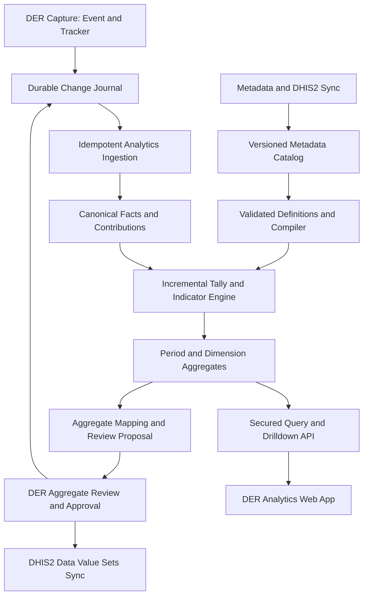
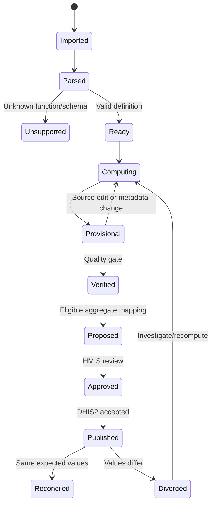

# DER Analytics — Site-Level Analytics Engine and Application

**Software Requirements Specification | System Architecture | Clinical and Aggregate Reporting Analytics | UI/UX | Acceptance and Evaluation**  
**Version:** 1.0 (implementation baseline)  
**Target:** DER Server and DER Client; interoperable with DHIS2 2.41, 2.42, 2.43 and 2.44  
**Status:** Design specification; not an assertion of native DHIS2 execution parity or a completed implementation  
**Date:** 10 November 2026

---

## 1. Executive summary and design decisions

DER Analytics is a **site-local, offline-capable analytics engine and web application** for event programs, tracker enrollments, tracked entities, program indicators, program-stage data, aggregate datasets and departmental operations. Its principal job is to provide reliable, explainable, near-real-time results from the **site's committed data**, even while the central DHIS2 instance or the WAN is unavailable. It provides authorised drilldowns back to the records that contributed to each number. It must **not** pretend that a local partial dataset is the definitive national DHIS2 analytics output.

Decisions:

1. The **DER Server** owns canonical site analytics state, an incremental computation pipeline, snapshots, query authorisation, data lineage, and the publication bridge to aggregate reporting. DER Client provides views and offline cached authorised analyses; a browser is not the authority for computing facility-wide statistics.
2. Use a **DHIS2-compatible metadata-aware expression compiler**, not JavaScript `eval` or direct arbitrary SQL. A support matrix explicitly lists compatible expressions, missing functions and unsupported syntax per DHIS2 version. Unsupported indicators are flagged, not guessed.
3. Distinguish **live provisional**, **locally verified**, **published to aggregate workspace**, **approved for submission**, and **reconciled with central DHIS2** values.
4. Partition calculations by site, source organisation unit, event/enrollment date interpretation, source programme, clinical dimensions and configurable period. Respect source ownership, write permissions, and metadata snapshots.
5. Never confuse **visits, events, enrollments, unique patients, admissions, episodes, discharges, deaths, diagnoses, and cases**. Every metric defines grain, counting unit, denominators, event status, date attribution, org unit and deduplication policy.
6. Adopt **incremental upsert/retraction**: when a patient event changes, the previous contribution is removed before the new version is applied. Replay, deletion, transfer and conflicts must not double count.
7. A drilldown uses an explainable **lineage query** from a computed cell to permitted source contributions. Patient-level details require strict role-based authorisation and audit trails.
8. Create aggregate reporting proposals only via explicit **approved indicator-to-data-element mappings**, never by assuming that every tracker program indicator is equivalent to a DHIS2 aggregate data element.

**Scope note:** This specification describes intended DER features. It does not change the official DHIS2 APIs or assert full parity with every expression, period type or reporting rule. Validate each integration against the actual target server.

## 2. Relationship to the existing DER hospital design

DER Capture manages programmes, tracker enrollments and events. DER Distributed Aggregate Capture manages a parent dataset, native DHIS2 sections, logical subsections, service-point/device assignments, validation and approval. DER Analytics consumes committed versions from both and computes local measures and authorised reportable aggregates. Source data are never replaced by analytics output.



### 2.1 Existing parent aggregate reporting catalogue

The previously prepared general-hospital package contains 15 parent datasets, 175 native sections, and 1,039 aggregate data elements. The table below is extracted from that package and **does not constitute a claim that each listed measure is automatically derivable from Tracker**.

| Code | Parent dataset | Period | Sections | Distinct section DEs |
|---|---|---|---:|---:|
| `OPDS0001` | Outpatient Department - Monthly Report | Monthly | 39 | 238 |
| `IPDS0001` | Inpatient Department - Monthly Report | Monthly | 25 | 188 |
| `ERDS0001` | Emergency Department - Monthly Report | Monthly | 11 | 87 |
| `MTDS0001` | Maternity and Newborn - Monthly Report | Monthly | 10 | 58 |
| `ANDS0001` | Maternal, Child and Reproductive Health - Monthly Report | Monthly | 14 | 54 |
| `IMDS0001` | Immunisation - Monthly Programme Report | Monthly | 3 | 12 |
| `HVDS0001` | HIV Care - Monthly Programme Report | Monthly | 5 | 23 |
| `TBDS0001` | Tuberculosis and Leprosy - Monthly Programme Report | Monthly | 5 | 25 |
| `LBDS0001` | Diagnostic Services - Monthly Report | Monthly | 15 | 86 |
| `SUDS0001` | Surgery, Procedures and Sterilisation - Monthly Report | Monthly | 10 | 49 |
| `PHDS0001` | Pharmacy and Supply Chain - Monthly Report | Monthly | 10 | 50 |
| `BLDS0001` | Billing and Financial Services - Monthly Report | Monthly | 5 | 23 |
| `ICDS0001` | Infection Prevention and Patient Safety - Monthly Report | Monthly | 5 | 21 |
| `HMDS0001` | Hospital Management, Records and Quality - Monthly Report | Monthly | 15 | 53 |
| `SRDS0001` | Communicable Disease Surveillance - Weekly Report | Weekly | 3 | 72 |

These parent datasets can contain many logically assigned sub-workflows. DER Analytics must expose drilldown by parent dataset → service group → native section → DER subsection → metric/disaggregation → authorised contributing source records.

### 2.2 Systems of record and authority

| Concern | System of record | DER Analytics responsibility |
|---|---|---|
| Patient, enrollment, event | DER site operational store while pending; central DHIS2 after accepted reconciliation per agreed rules | Read-versioned projections, source links |
| Hospital stock deduction | DER Inventory or designated eLMIS ledger | Read-only movement and balance-derived metrics |
| DHIS2 metadata | Central DHIS2 metadata, held as versioned local snapshots | Interpret semantics using exactly the compiled snapshot |
| Department report section | DER Aggregate Capture workspace | Suggest computable numbers, show provenance and workflow status |
| Submitted aggregate value | DHIS2 dataValueSet once acknowledged | Reconcile and show differences; never silently overwrite |
| Indicator definitions | DHIS2 programme indicators / governed DER derived indicators | Compile, execute or declare unsupported |

## 3. Goals, users, boundaries, assumptions

**Goals:** Near-real-time local summaries; clinical/operational monitoring; weekly/monthly/other supported periods; longitudinal trend and cohort analytics; diagnosis/case and mortality reporting; explainable drilldowns; offline site continuity; workload visibility; explicit aggregation publication; verifiable consistency with central results.

**Personas:** HMIS officer; hospital administrator; programme manager; department head; clinician with a treatment relationship; pharmacist; laboratory lead; site analyst; quality officer; system administrator; privacy auditor. Each persona sees only authorised organisations, programmes, fields and record levels.

**Not in scope for the initial engine:** population-level national deduplication across disconnected sites; clinical decision-making without review; automatic medical diagnosis; arbitrary execution of unknown DHIS2 functions; public disclosure of patient identities; a replacement for central DHIS2 analytics infrastructure; unrestricted query access to personally identifiable health data.

**Assumptions:** The site can access a durable local database and metadata snapshots; recording events and enrollments preserves stable IDs and change versions; facility time zone is configured, usually Africa/Kampala for Uganda deployments; explicit retention and lawful-use policies exist.

## 4. Detailed functional requirements

The IDs below are stable software requirements, not DHIS2 metadata codes. `MUST` means required before production; `SHOULD` means recommended for a full release; `MAY` means optional extension.

### 4.1 Metadata discovery, compatibility and expression engine

| ID | Level | Requirement |
|---|---|---|
| `AN-FR-001` | MUST | Ingest DHIS2 programme, program stage, data element, option, tracked entity attribute, indicator, category, org unit and reporting metadata by immutable revision. |
| `AN-FR-002` | MUST | Parse the configured program indicator analytics type (EVENT/ENROLLMENT), aggregation type, expression, filter, program, period boundaries and organisation-unit attribution. |
| `AN-FR-003` | MUST | Maintain a versioned support matrix for DHIS2 2.41–2.44 expression functions, constructs, variable syntax and semantics. |
| `AN-FR-004` | MUST | Reject unknown expressions and missing metadata references with actionable diagnostics; never silently return zero. |
| `AN-FR-005` | MUST | Compile valid definitions into a typed, safe internal expression AST with explicit null, numeric, date and boolean semantics. |
| `AN-FR-006` | MUST | Track dependency graphs so changed events or metadata invalidate only affected indicators/partitions. |
| `AN-FR-007` | SHOULD | Support local derived metrics as separately governed definitions with source, owner, rationale and version. |
| `AN-FR-008` | MUST | Expose indicator explain plans and the exact definition version used for each result. |

### 4.2 Data ingestion, state and quality

| ID | Level | Requirement |
|---|---|---|
| `AN-FR-009` | MUST | Consume committed event, tracked entity, enrollment, relationship and approved aggregate updates from a durable change stream. |
| `AN-FR-010` | MUST | Deduplicate by immutable change identifier and source-record version and process updates exactly once in observable effect. |
| `AN-FR-011` | MUST | Apply retraction and replacement of prior contributions when an event changes, is deleted, moves period, changes org unit, or changes eligibility. |
| `AN-FR-012` | MUST | Preserve soft-deleted, quarantined, conflicted and rejected source statuses without conflating them with valid records. |
| `AN-FR-013` | MUST | Define policy for completed, active, overdue, cancelled and pending event/enrollment states per metric. |
| `AN-FR-014` | MUST | Handle concurrent capture, late-arriving data, delayed peer changes and deterministic replay after restart. |
| `AN-FR-015` | MUST | Log data-quality exceptions, parse failures, missing codes, out-of-range values and orphaned references. |
| `AN-FR-016` | SHOULD | Expose indicator eligibility/exclusion counts alongside reported values where privacy rules permit. |

### 4.3 Tally, tracker and programme indicator computation

| ID | Level | Requirement |
|---|---|---|
| `AN-FR-017` | MUST | Support event count, enrollment count, distinct tracked-entity count, episodes, admissions, diagnoses, referrals, outcomes and relevant stock movement tallies as separate grains. |
| `AN-FR-018` | MUST | Support counts, filtered counts, sums, minima, maxima, means, ratios, percentages, cohort retention and validated standard deviation/variance where declared. |
| `AN-FR-019` | MUST | Define denominator-zero behaviour, missing-data treatment and rounding per metric, not by arbitrary frontend defaults. |
| `AN-FR-020` | MUST | Support repeatable stages, latest-per-enrollment selection, stage-specific event attribution and explicit temporal windows. |
| `AN-FR-021` | MUST | Prevent double-counting across service points when a clinical encounter involves multiple stages or devices. |
| `AN-FR-022` | MUST | Support standardised diagnosis grouping via governed local-to-ICD mapping and record unknown/unmapped codes separately. |
| `AN-FR-023` | MUST | Calculate all-cause and cause-specific mortality from defined death events/outcomes and cause attribution, with case-fatality defined separately. |
| `AN-FR-024` | SHOULD | Support multi-stage episode-derived measures such as referral completion, lab turnaround and prescription-to-dispensing times. |
| `AN-FR-025` | MUST | Mark approximate, provisional or incomplete measures explicitly and disallow publication without a configured quality gate. |

### 4.4 Periods, attribution and dimensions

| ID | Level | Requirement |
|---|---|---|
| `AN-FR-026` | MUST | Provide canonical period generators for day, week, month, quarter, half-year and year with explicit time zone and calendar rules. |
| `AN-FR-027` | MUST | Support configured DHIS2-compatible week variants and fiscal-year types only after version-specific verification. |
| `AN-FR-028` | MUST | Use half-open local instant windows [start, end) internally to avoid overlapping boundary records. |
| `AN-FR-029` | MUST | Support date-of-event, date-of-enrollment, incident date, discharge date and other approved attribution bases per metric. |
| `AN-FR-030` | MUST | Support org unit at event, enrollment, registration and authorised location rollups with explicit rules. |
| `AN-FR-031` | MUST | Provide sex, age-at-event, age-at-outcome, diagnosis, result, service point, clinic, stage, ward and programme dimensions where metadata permits. |
| `AN-FR-032` | MUST | Use governed category groupings; reject overlapping additive age bands and unknown/other omission. |
| `AN-FR-033` | SHOULD | Support comparable period-over-period and time-series queries including partial-period warnings. |

### 4.5 Analytics → aggregate reporting

| ID | Level | Requirement |
|---|---|---|
| `AN-FR-034` | MUST | Store versioned mappings from indicator/measure to dataElement + categoryOptionCombo + attributeOptionCombo + orgUnit + period. |
| `AN-FR-035` | MUST | Generate proposals to prefill DER Aggregate Capture rather than directly marking datasets complete. |
| `AN-FR-036` | MUST | Maintain human review, approval, source provenance, override reason and locking for regulated submissions. |
| `AN-FR-037` | MUST | Keep observed tracker-derived values and user-entered aggregate reported values separate for reconciliation. |
| `AN-FR-038` | MUST | Never duplicate sums of overlapping clinic sections or disaggregations to produce hospital totals. |
| `AN-FR-039` | SHOULD | Support differences against central DHIS2 analytics, dataValueSets and approved hospital submissions. |
| `AN-FR-040` | MUST | Publish only via a mapping compatible with the target DHIS2 version and stable metadata UIDs. |

### 4.6 Query, drilldown and visual application

| ID | Level | Requirement |
|---|---|---|
| `AN-FR-041` | MUST | Provide dashboard, chart, pivot, disaggregation table, patient-safe drilldown and record detail navigation as separate views. |
| `AN-FR-042` | MUST | Support navigation hierarchy: overview > care setting > programme > stage/section > measure > dimension cell > source record when authorised. |
| `AN-FR-043` | MUST | Include filters for periods, units, programme, stage, site, service point, category/diagnosis and quality status. |
| `AN-FR-044` | MUST | Support sorting, paginated result sets, search, saved views and copy/export under per-user access controls. |
| `AN-FR-045` | MUST | Explain cell numerator, denominator, count grain, period range, included states, exclusions and last updated timestamp. |
| `AN-FR-046` | MUST | Display aggregation freshness, metadata revision, source version, completeness, sync state and reconciliation state. |
| `AN-FR-047` | MUST | Use privacy suppression and protected export for small clinical counts and identifiers. |
| `AN-FR-048` | SHOULD | Offer charts (trend, bar, stacked bars, line, pivot, heatmap) selected by measure/dimension semantics. |
| `AN-FR-049` | SHOULD | Enable scheduled/triggered site reports through authorised operational scheduling when deployed. |

### 4.7 Security, audit and operations

| ID | Level | Requirement |
|---|---|---|
| `AN-FR-050` | MUST | Apply organisation-unit and programme authorisation to the underlying query and drilldown, not solely frontend filters. |
| `AN-FR-051` | MUST | Implement row/field-level protection, purpose-based audit and export logging for personally identifiable clinical data. |
| `AN-FR-052` | MUST | Encrypt data in transit and at rest using the platform security architecture and protect analytics caches/backups. |
| `AN-FR-053` | MUST | Provide resilient queue, retry, dead-letter quarantine, replay, metrics and alerting for failed computations. |
| `AN-FR-054` | MUST | Allow recomputation following changed metadata, corrections, time-zone configuration or backfilled records. |
| `AN-FR-055` | MUST | Support tenancy isolation per site with explicit cross-site visibility only after central authorisation. |
| `AN-FR-056` | SHOULD | Offer incremental recomputation progress, worker capacity limits and rate-limited complex queries. |
| `AN-FR-057` | MUST | Preserve user-visible decision provenance for every aggregate cell proposed for submission. |

## 5. Period type catalogue and date semantics

**Date representation:** Use `date` for clinical event dates and `timestamp with time zone` for writes/ingestion. Convert event date into facility-local period boundaries, then use `[startInstant, endInstant)` comparisons. Never assume UTC midnight corresponds to local midnight. A metric may explicitly use event date, enrollment date, incident date or discharge date. Record that basis with the result.

| Logical period | Example | Intended behaviour | Compatibility handling |
|---|---|---|---|
| Daily | `20261110` | Local calendar day | Normalise DHIS2 period syntax at adapter |
| Weekly ISO | `2026W46` | ISO Monday–Sunday | Explicitly name ISO week system |
| Weekly variants | Saturday/Sunday/Wednesday/Thursday start | Where mandated | Verify exact target DHIS2 period identifiers before enabling |
| Biweekly | Two-week period | Only when site reporting requires | Align with native target semantics |
| Monthly | `202611` | Calendar month | Core HMIS mapping |
| Bimonthly | `202611B` (illustrative only) | Two-month window | Never send illustrative ID without validation |
| Quarterly | `2026Q4` | Three calendar months | Core |
| Six-monthly | `2026S2` | Six calendar months | Check native semantics |
| Yearly | `2026` | Calendar year | Core |
| Financial years | Site-specific start month | Fiscal boundary window | Store explicit start/end and target-code mapping |
| Rolling windows | Last 7/30/90 days | Dynamic dashboards | Derived local window, not automatically a DHIS2 period |
| Custom range | 2026-10-01 to 2026-11-10 | Ad hoc analysis | Not directly an aggregate dataset period unless mapped |

**Period examples:** A consultation recorded on 2026-11-10 local time belongs to November 2026, Q4 2026 and ISO week 46. A correction to an event date in a different month must retract the prior month contribution and insert into the new month. District or organisational rollups must not re-add the same patient's activity twice when it was already aggregated at a parent level. Some DHIS2 period syntax differs by release or period variant; adapter unit tests must verify every enabled format.

### 5.1 Supported dimension defaults

- **Care setting:** OPD, IPD, Emergency, Maternity, diagnostics, other approved departments.
- **Clinical programme:** the actual DHIS2 program UID (not display name) and stage UID.
- **Person dimensions:** sex/gender according to configured meaning, age at relevant anchor date, documented residence, clinical population grouping when lawful.
- **Clinical conditions:** diagnosis code, case status, underlying cause, secondary cause, clinical outcome, case type (new/revisit), severity.
- **Operational dimensions:** service point, source event org unit, enrolment org unit, ward, team, service type, facility ownership if configured.
- **Reporting dimensions:** period, organisation unit, indicator and categoryOptionCombo where mapped.
- **Quality dimensions:** pending, verified, conflicted, corrected, missing, approved, reconciled.

Cross-cutting age-group definitions must not be conflated with unknown values; `Unknown` remains a visible category and excluded from age-stratified denominators only when explicitly specified.

## 6. Calculation semantics and correctness contract

### 6.1 Metric definition schema

Every derived metric must specify: `id`, `name`, `code`, `owner`, `grain`, `programUid`, `stageUids`, `aggregationType`, `analyticsType`, `expressionAst`, `filterAst`, `dateAnchor`, `orgUnitAnchor`, `sourceStates`, `distinctKey`, `dimensions`, `denominator`, `unit`, `nullPolicy`, `roundingPolicy`, `minCellSize`, `metadataRevision`, `effectivePeriod`, `mappingStatus`, `sourceLineagePolicy` and `version`.

A metric is **not aggregatable** unless `grain` and `aggregation` are compatible: a mean of site-level averages must be weighted by their source counts, and a distinct-patient count cannot be summed across arbitrary sites to obtain national unique patients.

### 6.2 Event vs enrollment indicator behaviour

DHIS2 distinguishes event-type program indicators from enrollment-type indicators. Event analytics is typically anchored to event org unit and event date; enrollment analytics is typically anchored to enrollment org unit and enrollment date. Enrollment analytics may reference events across stages, and a repeatable stage can have special latest-event semantics. DER must use the definition and target version's semantics, not a generic count of event rows. Any ambiguity triggers an unsupported/verification state rather than an apparently successful result.

**Conceptual execution order:** determine eligible org unit/period, filter candidate records, evaluate expression at the configured grain, then apply aggregation; for downstream ratio indicators evaluate numerator and denominator according to their separate definitions. Custom aggregation functions require verified semantics.

### 6.3 Clinical counting contracts

| Metric | Correct source grain | Date basis | Primary deduplication/interpretation |
|---|---|---|---|
| OPD attendances | Completed OPD encounter | Encounter date | Unique encounter UID, not every clinical stage |
| Unique OPD patients | Patient UID | Encounter date | Count distinct within period/site, not sum of weekly distinct counts |
| New OPD disease cases | Valid qualifying encounter/case definition | Case or encounter date | New-case rule and diagnosis role required |
| IPD admissions | Admission episode | Admission date | One per admission, not per ward transfer |
| IPD discharges | Admission episode | Discharge date | Deaths, referrals and absconded outcomes distinctly classified |
| Inpatient deaths | Deceased admission episode | Death date | Explicit death outcome and cause attribution |
| Diagnoses | Primary diagnosis per defined encounter/episode | Encounter/discharge date | Do not sum all listed secondary diagnoses as unique cases |
| Lab tests performed | Test-level service unit | Result/perform date | Request with multiple tests expands to distinct tests |
| Medication dispensed | Authoritative dispensing line transaction | Actual dispense date | Replays never deduct or tally twice |
| Maternal deliveries | Delivery episode | Delivery date | Multiple births count one delivery but multiple infants |
| Live births | Individual live-born infant | Birth date | Twins count as two live births |
| Stillbirths | Birth outcome event | Birth date | Apply governed gestational-age/weight threshold |
| Perinatal mortality | Stillbirth/early neonatal criteria | Birth/death dates | Follow approved national definition |
| Referrals completed | Completed referral request | Completion date | Do not count task attempts or duplicate handoffs |

### 6.4 Example correctness vectors

**Vector A — changed event:** Event E1 initially counts for October. Its date is corrected to November. October count becomes 0 and November count becomes 1. Replaying the same correction again changes nothing.

**Vector B — visit with 4 stages:** A single OPD encounter has registration, triage, consultation and lab stage events. OPD encounter tally = 1, stage events = 4, laboratory test tally depends on test lines. Distinct patients = 1.

**Vector C — two visits:** Patient P1 attends twice in November. OPD attendances = 2; distinct patients = 1. Summing daily distinct counts could yield 2 and is prohibited for monthly unique-patient statistics.

**Vector D — mortality:** One inpatient admission ends in death with documented underlying cause and two secondary diagnoses. Inpatient deaths = 1; underlying-cause row increments once; secondary diagnoses are not treated as additional deaths.

**Vector E — denominator zero:** In a ward with zero discharges, inpatient mortality percentage for discharge episodes is **undefined** (shown as “No denominator”), not 0%.

**Vector F — provisional conflict:** An event is disputed between two peers. Keep last reconciled committed contribution and label potential freshness/quality impact according to the chosen conflict policy; do not count both versions.

## 7. Engine architecture and processing flow

### 7.1 Recommended server modules

1. **Metadata Synchroniser:** Snapshot owner, UID, options, type, programme/stage and indicator definitions. Detect semantic diff and affected lineage.
2. **Expression Lexer/Parser:** Parse only allowed DHIS2 syntax for each version; generate AST; type-check and annotate dependencies.
3. **Expression Executor:** Evaluate typed expression per event or enrollment snapshot with deterministic null and date handling.
4. **Incremental Change Consumer:** Read durable change journal, claim update atomically, restore previous contribution and apply new one.
5. **Contribution Ledger:** Store one stable, versioned contribution per metric, source/grain key, period and dimension cell.
6. **Aggregation Materializer:** Maintain count/sum/mean-state/min/max or rebuild where retractions are nontrivial; distinct counts need explicit exact-set support or clear approximation labels.
7. **Period Resolver:** Produce canonical time windows and target-compatible DHIS2 period identifiers.
8. **Dimension Resolver:** Map age groups, diagnosis values, clinical statuses, category combinations and service ownership.
9. **Quality and Reconciliation:** Compute source-completeness, mismatched aggregates, failed expressions, late data and audit status.
10. **Query Planner and API:** Apply authorisation first, aggregate or paginate, and return data with source lineage and freshness.
11. **Aggregate Proposal Mapper:** Create DER Aggregate Capture prefill proposals with review state, not direct writes.
12. **Observability and Control:** Lag, throughput, queue depth, stale partitions, errors, replay controls, snapshot diagnostics.

### 7.2 State model



### 7.3 Database projection schema (illustrative, DER-owned)

```sql
CREATE TABLE analytics_definition (
  id UUID PRIMARY KEY, source_uid VARCHAR(24), code VARCHAR(32),
  definition_version INTEGER NOT NULL, metadata_hash TEXT NOT NULL,
  analytics_type TEXT NOT NULL, aggregation_type TEXT NOT NULL,
  compiled_ast JSONB, support_state TEXT NOT NULL,
  definition JSONB NOT NULL, effective_from TIMESTAMPTZ NOT NULL
);
CREATE TABLE analytics_source_cursor (
  site_id UUID NOT NULL, stream TEXT NOT NULL, cursor BIGINT NOT NULL,
  PRIMARY KEY (site_id, stream)
);
CREATE TABLE analytics_contribution (
  site_id UUID NOT NULL, metric_id UUID NOT NULL,
  definition_version INTEGER NOT NULL, source_key TEXT NOT NULL,
  source_version TEXT NOT NULL, period_key TEXT NOT NULL,
  org_unit_uid TEXT NOT NULL, dimension_key TEXT NOT NULL,
  contribution_value NUMERIC, eligibility BOOLEAN NOT NULL,
  source_state TEXT NOT NULL, updated_at TIMESTAMPTZ NOT NULL,
  PRIMARY KEY(site_id, metric_id, definition_version, source_key, period_key, org_unit_uid, dimension_key)
);
CREATE TABLE analytics_cell (
  site_id UUID NOT NULL, metric_id UUID NOT NULL,
  definition_version INTEGER NOT NULL, period_key TEXT NOT NULL,
  org_unit_uid TEXT NOT NULL, dimension_key TEXT NOT NULL,
  count_value BIGINT, sum_value NUMERIC, value NUMERIC,
  freshness_at TIMESTAMPTZ, quality_state TEXT NOT NULL,
  PRIMARY KEY(site_id, metric_id, definition_version, period_key, org_unit_uid, dimension_key)
);
CREATE TABLE analytics_publication (
  proposal_id UUID PRIMARY KEY, metric_id UUID NOT NULL,
  dataset_uid TEXT NOT NULL, data_element_uid TEXT NOT NULL,
  category_option_combo_uid TEXT NOT NULL, attribute_option_combo_uid TEXT NOT NULL,
  period_key TEXT NOT NULL, org_unit_uid TEXT NOT NULL,
  proposed_value NUMERIC, reviewed_value NUMERIC,
  state TEXT NOT NULL, provenance JSONB NOT NULL
);
```

**Implementation note:** The simplified contribution key must be extended with a stable contribution-discriminator for definitions that emit multiple cells per source record (e.g., multivalued clinical dimensions). The ingestion transaction must atomically update contribution history and enqueue affected aggregate cells. Non-invertible aggregation states (exact distinct, min/max) may need selective partition recomputation rather than a naive subtraction. Apply retention, indices, access controls, partitioning and encryption in the actual database migration.

### 7.4 Incremental algorithm

```text
onCommittedSourceChange(change):
  verifySignatureAndSiteOwnership(change)
  if journalVersionAlreadyApplied(change.id, change.version): return NO_OP
  affectedMetrics = dependencyGraph.forSource(change.sourceType, change.changedFields)
  transaction:
    for metric in affectedMetrics:
      prior = contributionLedger.find(metric, change.sourceUid)
      removeOrInvalidate(prior)
      current = loadCommittedVersion(change.sourceUid, change.version)
      if eligible(metric, current):
        contributions = execute(metric, current)  // zero-to-many cells
        upsertContributions(contributions)
      enqueueRebuildOrDelta(prior, contributions)
    advanceCursorAndCommit(change)
  asynchronouslyRecomputeQueuedCells()
  publishFreshnessAndQualityStatus()
```

Critical safety rules: do not materialise across uncommitted source transactions; never acknowledge journal cursor before durable processing; use bounded retries and dead-letter queues; store job reasons and version hashes; consider patient merge/identity correction as full dependent partition invalidation.

## 8. Analytics-to-aggregate mapping

DER shall read the 15 parent dataset definitions, their 175 native sections and DER logical-subsection manifest. The *mapping* is a governed object independent of DHIS2's metadata JSON. A valid mapping must specify the computation grain and the exact target cell, including category option combo and attribute option combo; period type must match the parent dataset. One target cell must have one authoritative publication route.

Example conceptual mapping (identifiers shown as placeholders, NOT importable DHIS2 UIDs):

```json
{
  "mappingId":"example-opd-attendance",
  "sourceMetricCode":"OPPI0001",
  "sourceGrain":"ENCOUNTER",
  "periodType":"Monthly",
  "dateAnchor":"encounterDate",
  "orgUnitAnchor":"eventOrgUnit",
  "target":{
    "datasetUid":"<actual-dataset-uid>",
    "dataElementUid":"<actual-data-element-uid>",
    "categoryOptionComboUid":"<resolved-coc-uid>",
    "attributeOptionComboUid":"<resolved-aoc-uid>"
  },
  "publicationMode":"REVIEW_REQUIRED",
  "overlapPolicy":"EXCLUSIVE_CELL_OWNER"
}
```

**Review behaviour:** Compare system-derived numerator with manual section totals; show coverage and potential double counting; flag a partial month or pending sync; capture review reason and approver; update only the intended DER aggregate workspace cell. Keep reported values frozen after approval unless formally reopened and audited. An approved aggregate workspace still uses native DHIS2 `dataValueSets` submission rules.

## 9. API contract (DER-owned, illustrative)

All endpoints are namespaced under `/api/analytics/v1` and follow normal session/token authorisation. The examples describe the proposed DER API, **not existing DHIS2 API endpoints**.

| Method | Path | Purpose |
|---|---|---|
| GET | `/capabilities` | Supported functions, periods, dimensions and version compatibility |
| GET | `/metrics` | Browse authorised metrics, definitions and support states |
| GET | `/periods?type=Monthly&year=2026` | Enumerate canonical period windows |
| POST | `/query` | Analytic matrix with filters, group-by, pagination and freshness |
| POST | `/timeseries` | Trend queries and partial-period flags |
| POST | `/drilldown` | Authorised contributing source rows and exclusions |
| GET | `/explain/{metricId}` | Formula, filter, grain, definition revision and support status |
| GET | `/quality` | Completeness, data drift, lag and error summary |
| POST | `/exports` | Audited CSV/XLSX/PDF output job |
| POST | `/aggregate-proposals` | Propose cells for DER Aggregate Capture review |
| GET | `/reconciliation` | Compare local, aggregate and central snapshots |
| POST | `/admin/recompute` | Protected recalculation by scope and reason |
| GET | `/admin/jobs` | Rebuild progress, queue lag, errors |

Example query:

```json
{
  "metrics":["OPPI0001"],
  "period":{"type":"Monthly","id":"202611"},
  "orgUnits":["<authorised-orgunit-uid>"],
  "dimensions":["sex","ageGroup","servicePoint"],
  "filters":{"program":"<program-uid>","sourceStatus":"COMMITTED"},
  "page":{"limit":100,"cursor":null}
}
```

A response includes `metricUid`, `period`, `periodWindow`, `definitionVersion`, `sourceSnapshotCursor`, `qualityState`, `freshnessAt`, `units`, cell values and `drilldownToken`. The drilldown token is an opaque short-lived server-side scope identifier; clients cannot forge filters to request broader access. Query input must be constrained to authorised dimensions and valid expressions.

## 10. Modern DER Analytics user experience

### 10.1 Application placement and navigation

DER Analytics launches from the DER app launcher in its own full-screen application shell. It uses the same visual design system as DER Capture: calm flat surfaces, restrained dividers, legible dense tables, no heavy borders/gradients, consistent spacing, keyboard support, accessible colours and predictable navigation. **Do not mix source lists and detailed forms on the same page.**

Navigation:

1. **Overview:** site analytics, period context, data freshness, configurable KPIs, alerts, pending validations.
2. **Explore:** dataset/programme selector, reusable dimensions, group-by, time-series, pivot, chart builder.
3. **Program Indicators:** searchable catalogue, supported/unsupported chips, definition inspection and execution trace.
4. **Tracker & Event Tally:** new events, visits, enrollments, stage throughput and case counts, segmented by time and service points.
5. **Hospital Reports:** the 15 parent datasets, native section and DER subsection coverage, calculated contributions and readiness.
6. **Drilldowns:** authorised list of contributing visits/enrollments/events, then a dedicated record detail page.
7. **Saved Analytics:** user/team saved views, shared dashboards, exports and comparison snapshots.
8. **Quality & Reconciliation:** incomplete records, mismatches, unmet formula dependencies and central sync status.
9. **Administration:** capability matrix, metadata versions, query limits, rebuild jobs, mapping configuration, access auditing.

### 10.2 Page architecture and interactions

**Overview page** — title, site/period badge, freshness timestamp, 4-6 configurable KPI cards, one main trend chart, a facility summary table and quality issues. A KPI click opens the metric detail, not an arbitrary chart. Empty/loading/error/no-permission states are distinct.

**Metric detail page** — metric name, definition, value, period, data-as-of, time series, stratified breakdown, confidence/quality warnings; clicking a non-suppressed cell opens drilldown. The calculation explanation is visible without leaving the page.

**Explore builder page** — two-panel mode: compact query controls (metric, time, program, org unit, dimensions, status) and a sizeable results area. Chart/pivot switches preserve filters. For results over thousands of cells, server-side pagination/virtualization is mandatory.

**Hospital reporting page** — dataset > service group > native section > logical subsection. Show source count, computed count, reported value, difference, completion and reviewer. Device-group assignment is visible as context, not an analytics permission bypass.

**Drilldown page** — header with exact originating chart cell and filter breadcrumbs; source rows with event date, clinical service, masked identity when appropriate, data state, provenance and navigation to record. When privacy threshold is not met, show a suppression explanation instead of identities.

**Record detail page** — dedicated view through authorised DER Capture route, never embedding editable capture form in the analytics table. Maintain return navigation to the originating metric and filter context.

**UX interactions:** deep links, saved filters, hover descriptions, patient-safe field masking, export confirmation for potentially sensitive data, keyboard and screen reader support, responsive tablets, no reliance on colour alone, theme consistency, print-friendly reporting.

### 10.3 Navigation state

Route format (illustrative): `/analytics/overview`, `/analytics/explore`, `/analytics/metrics/:metricId`, `/analytics/reports/:datasetUid`, `/analytics/drilldown/:scopeToken`, `/analytics/quality`, `/analytics/admin`. URL state holds non-sensitive filters; private record IDs and PHI must not be exposed in shareable query strings.

## 11. Drilldown and privacy contract

Drilldown is **not** a generic reverse SQL query from an aggregate count. It is a lineage-based, authorised operation with an explicit relationship to the metric version and the exact cell filters. Only appropriate metrics have record-level drilldowns; aggregate-only data submitted by a separate clinic might support a source document/reference but no patient row.

- All authorisation is rechecked by the server on every drilldown page and export request.
- Aggregate viewers can see numeric summaries, but only users with patient-record privileges and a permitted clinical purpose can open patient detail.
- Minimal necessary fields only; pseudonymisation/masking by default in management reports.
- Small-cell suppression threshold is configurable; suppressed cells must not be inferred through complementary totals, exports or repeated dimension queries.
- Count uniqueness guarantees apply only to the scoped site and definition; remote deduplication remains unresolved while offline.
- Audit filter changes, sensitive reads, exports, records opened and impersonation/break-glass actions.
- Never cache PHI in shared browser storage or service worker caches without specifically approved encryption and expiry controls.

## 12. Reconciliation with central DHIS2

DHIS2 central APIs can provide event analytics, tracked-entity analytics, program indicator values and aggregate analytics; central analytics tables may be refreshed asynchronously and may not include locally pending data. DER Analytics must compare only like-for-like metric definitions, periods, organisation units, statuses and snapshots; mismatches have classifications such as `LOCAL_PENDING_SYNC`, `CENTRAL_ANALYTICS_NOT_REFRESHED`, `METADATA_VERSION_DRIFT`, `INCOMPATIBLE_FORMULA`, `ORGUNIT_ATTRIBUTION`, `DATE_ANCHOR`, `DEDUP_POLICY`, `LATE_DATA`, `REJECTED_TRACKER_UPDATE` and `REAL_MISMATCH`.

A parity test is valid only when the upstream DHIS2 instance has acknowledged the relevant source revisions, the analytics refresh is complete, and the compared indicator and dimension semantics match. DER must not represent a local partial count as a verified replica of national totals.

## 13. Non-functional requirements and measurable targets

The following are *design acceptance targets*, subject to site hardware and realistic benchmark confirmation.

| ID | Quality | Target / test method |
|---|---|---|
| AN-NFR-001 | Availability | Reads for already-materialised metrics continue through WAN outage and central DHIS2 unavailability |
| AN-NFR-002 | Latency | 95% of ordinary single-site dashboard requests under 2 s on reference workload, after warm-up |
| AN-NFR-003 | Freshness | 95% of committed ordinary event updates reflected in relevant tally within 10 s on reference workload |
| AN-NFR-004 | Replay correctness | At-least-once event delivery must produce exactly-once observable tally effect |
| AN-NFR-005 | Durability | Loss of analytics worker must not lose journal events or approved publication audit records |
| AN-NFR-006 | Calculation integrity | Golden fixture results exact for integer counts, approved decimal tolerance for rate/mean |
| AN-NFR-007 | Privacy | No unauthorised record-level drilldown or export under privilege/tenant tests |
| AN-NFR-008 | Scale | Benchmark at 1 million events / 100,000 enrollments / 200 indicators without unbounded memory growth |
| AN-NFR-009 | Recovery | Worker restart and deterministic replay from committed cursor without count inflation |
| AN-NFR-010 | Observability | Expose ingestion lag, query p95, failed definitions, dead letters and stale partitions |
| AN-NFR-011 | Compatibility | Explicit tested matrix per DHIS2 2.41–2.44 expression/period/API adapter |
| AN-NFR-012 | Accessibility | Keyboard navigable, WCAG 2.2 AA design target for supported screens |
| AN-NFR-013 | Maintainability | Isolated parser, engine, storage and UI components with contract tests |
| AN-NFR-014 | Security | Tenant/site isolation; encrypted transport and storage; least-privilege administration |
| AN-NFR-015 | Data quality | Never publish unsupported, partial, conflicted or unmapped metrics as verified |

## 14. Testing matrix and acceptance criteria

| Test | Scenario | Expected result |
|---|---|---|
| AT-01 | 1 visit, 4 stage events | OPD attendance 1; stage counts 4; no duplicate person |
| AT-02 | 2 encounters, same patient | Attentions 2, distinct patient 1 |
| AT-03 | Event date changed across months | Old period retracted; new period inserted |
| AT-04 | Event deletion/cancellation | Contribution removed under policy |
| AT-05 | Duplicate journal delivery | No change to result |
| AT-06 | Concurrent device writes | One canonical committed version contributes |
| AT-07 | WAN offline then recovery | Local tally maintained; central reconciliation correctly labelled |
| AT-08 | Enrollment PI across repeat stages | Correct semantics per validated target DHIS2 version |
| AT-09 | Missing option code | Report error/unknown, never silently classify as other disease |
| AT-10 | Unknown expression function | Definition unsupported with diagnostic, no fake 0 |
| AT-11 | Time-zone month boundary | Correct Kampala reporting month |
| AT-12 | Patient identity merge | Distinct-patient count recomputed without duplication |
| AT-13 | Death with primary and secondary causes | One death under assigned underlying cause |
| AT-14 | Small cell drilldown | Suppression and server-side permission enforcement |
| AT-15 | Export attempt without permission | Denied, audited |
| AT-16 | Metadata change to indicator filter | Impacted cells invalidated, recomputed with revision |
| AT-17 | Aggregate proposal for unmapped cell | Rejected, not silently submitted |
| AT-18 | Different aggregate and tracker values | Difference shown with status and provenance |
| AT-19 | Repeated weekly-to-monthly rollup | Uniques recomputed, never summed blindly |
| AT-20 | Materialisation worker crash during transaction | Recovery yields exact expected result |

### 14.1 Reference workload and evaluation

Use synthetic (not real patient) fixtures spanning outpatient, inpatient, emergency, laboratory, maternal and specialised clinics, plus status transitions, updates, corrections, backfills, multi-device concurrency, outages and metadata drift. Record event count, stage distributions, per-indicator execution time, memory/CPU, queue depth, incremental throughput, dashboard query p50/p95/p99, correctness versus a simple reference batch implementation, and controlled parity against central DHIS2 after its analytics refresh.

## 15. Implementation phases and deliverables

| Phase | Engine scope | App/QA deliverable | Exit gate |
|---|---|---|---|
| P1 | Metadata snapshots, source journal consumer, period service | Catalog page and readiness diagnostics | Versioned read models and cursor replay tests |
| P2 | Event count, enrollment count, stable-tally states | Overview, event/explore pages | Correct mutable-event retraction and drilldown |
| P3 | Program indicator parser/AST and safe evaluator | Metric definition/unsupported details | Golden tests for verified DHIS2 functions |
| P4 | Dimension rollups, exact distinct, cohort/temporal metrics | Pivot, charts, time series | Correct age/sex, date and site attribution |
| P5 | Aggregate cell mapping, provenance, approval integration | Hospital reporting and reconciliation | No unapproved dataValueSet publication |
| P6 | Security hardening, observability, performance and compatibility | Saved views, audit, admin controls | Load/outage/authorization and per-version sign-off |

### 15.1 Software deliverables

- Versioned SRS with functional and non-functional requirements, traceability and threat model.
- Technical ADRs for local computation authority, expression language, rollup/grain and publication policy.
- Metadata compatibility manifest for DHIS2 2.41–2.44 and explicit unsupported features.
- Typed indicator parser/AST, evaluator, period library and reference test vectors.
- Durable ingestion, canonical projection, contribution ledger, aggregation materializer and reconciliation services.
- Authenticated REST API with OpenAPI specification, limits and error codes.
- Full DER Analytics web UI, dashboard, Explore, metric detail, drilldown, reporting, quality and admin views.
- Load/fault/permission/parity tests, synthetic fixtures, deployment charts/configurations and runbooks.

## 16. DHIS2 interoperability references

Authoritative references to verify during implementation:

1. DHIS2, *Tracker Analytics - System Design*, https://docs.dhis2.org/en/implement/database-design/tracker-system-design/tracker-analytics.html — event and enrollment indicator granularity, organisation unit/period interpretation and repeatable stages.
2. DHIS2, *Configuring Programs (2.43)*, https://docs.dhis2.org/en/use/user-guides/dhis-core-version-243/configuring-the-system/programs.html — program indicator components, filters and aggregation types.
3. DHIS2, *Analytics Web API (2.42)*, https://docs.dhis2.org/en/develop/using-the-api/dhis-core-version-242/analytics.html — analytics, event query, aggregate dimensions and API shape.
4. DHIS2, *Analytics Web API (2.41)*, https://docs.dhis2.org/en/develop/using-the-api/dhis-core-version-241/analytics.html — earlier-version reference for compatibility testing.
5. DER Hospital Consolidated Aggregate Reporting metadata, locally supplied in this conversation, containing 15 parent datasets and 175 sections (baseline only; full implementation requires actual import validation).

**Clinical standards note:** WHO routine facility reporting and ICD-11, LOINC, SNOMED CT, ATC, UCUM and approved national HMIS classifications may guide the indicator and terminology governance layer, but DER should not assert a standard terminology match without an approved and versioned mapping.

## 17. Final acceptance decision

Release DER Analytics to site production only after the following are all demonstrated: source edits reliably retract prior contributions; indicator semantics are explicitly supported for the target DHIS2 version; patient-level drilldown access is enforced on the server; aggregated proposals cannot bypass local review; central-versus-local differences can be explained; periods and age groups are correct; and an outage/replay test produces identical results to the verified baseline.
