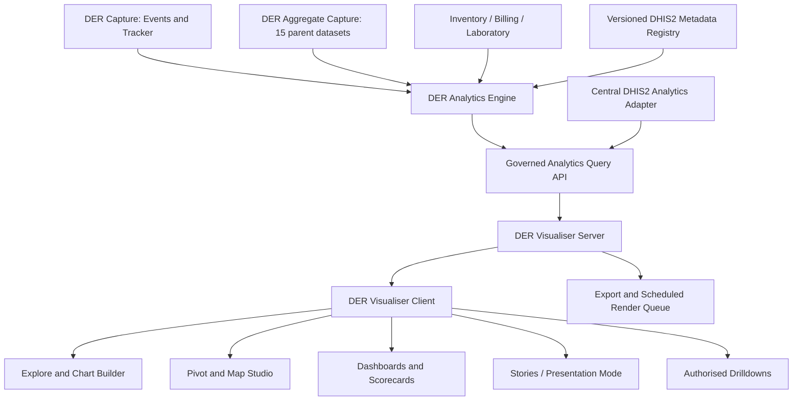
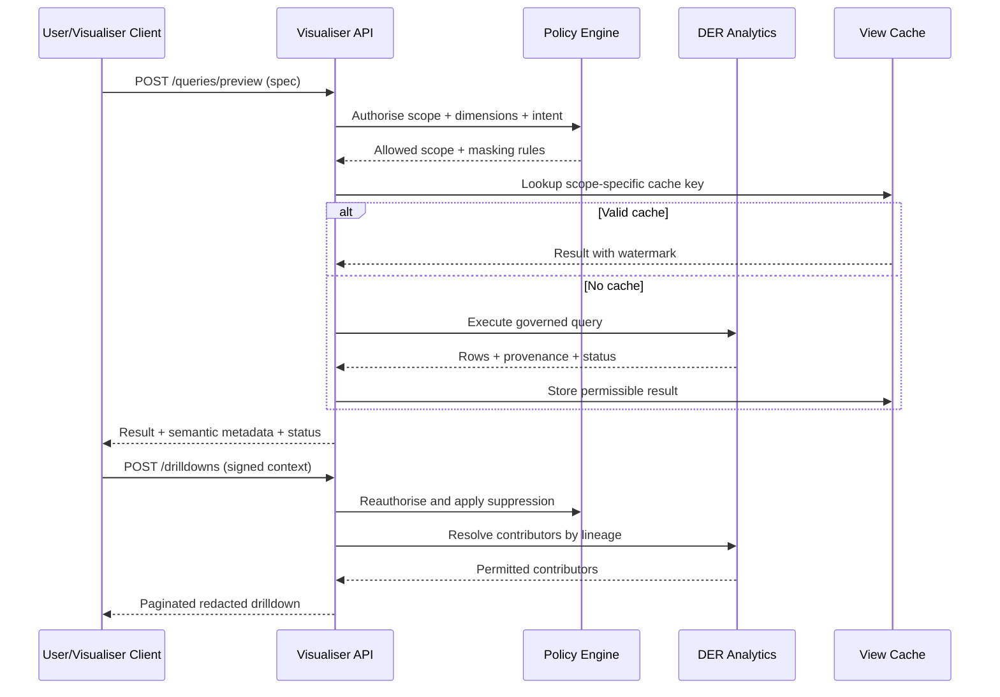

# DER Visualiser — Comprehensive Software Requirements and Implementation Architecture

**Software Requirements Specification (SRS) • Visual Analytics Architecture • Modern UI/UX Specification • API Contracts • Security • Quality Assurance**  
**Version:** 1.0 — engineering design baseline  
**Date:** 10 November 2026  
**System:** DHIS2 Edge Runtime (DER) | Server and Client  
**Target DHIS2 interoperability:** 2.41, 2.42, 2.43, 2.44 (feature-by-feature verification required)  
**Status:** Proposed implementation, not an implemented or live-tested app

---

## 1. Executive summary

**DER Visualiser** is a dedicated site-level, metadata-aware application for **analysing, visualising, exploring and presenting** data made available by DER Analytics. It enables authorised clinicians, HMIS officers, programme managers and hospital leadership to create reusable charts, pivot tables, maps, dashboards, scorecards, analytical narratives, and fullscreen presentation stories while the site operates with or without WAN connectivity.

The separation of responsibilities is deliberate: **DER Analytics executes calculations, governs definitions, handles period semantics and produces traceable result sets; DER Visualiser composes and renders approved views of those results.** Visualiser never independently recomputes clinical program indicators using arbitrary browser arithmetic. It may implement presentation-only calculations (e.g. chart percentages of an already approved breakdown) when these are declared and visibly labelled.

**Foundational decisions**

1. Make Visualiser an app in the DER app launcher, with its own route hierarchy, but retain the existing DER shell and familiar DHIS2-inspired interaction model.
2. Reuse Analytics query models and metadata references (DHIS2 UIDs, stable `SSTTNNNN` codes where applicable), without copying patient data into saved charts.
3. Work from site-local Analytics materialisations; where configured, use the central DHIS2 analytics adapter as a **separately labelled** comparison source.
4. Persist visualisation definitions, dashboards, story decks, user preferences, access controls and revisions in DER Server; persist only a permitted encrypted view cache on clients.
5. Drill from visual → segment → aggregate cell → authorized de-identified contributors or individual records, with explicit role/purpose permission and audit.
6. Display **data status** (live provisional, locally verified, aggregate approved, central reconciled), **as-of timestamp**, **period interpretation**, and **source coverage** on every visualisation.
7. Dynamic metadata change requires safe remapping/migration; incompatible visualisations are not silently rewritten or shown as valid.
8. Publishing, sharing and exporting must comply with patient privacy, minimum-cell suppression and facility policy.
9. Provide both rapid analysis and polished presentation outputs without embedding untrusted code, SQL or arbitrary HTML in chart definitions.
10. Complete accessibility, responsive layouts, keyboard navigation, localisation and clear no-data/partial-data states are first-class requirements.

### 1.1 In-scope deliverable

An implementable design encompassing the DER Visualiser **web client**, **server API**, **visualisation query orchestration**, **saved definitions and dashboards**, **mapping**, **presentation/export**, **access controls**, **audit**, **monitoring**, **testing**, and **phased implementation**. This document deliberately does **not** claim to provide production code or ready-to-import DHIS2 visualisation metadata.

## 2. Relationship to the DER platform



**Non-negotiable division:** analytics owns facts, metric definitions, denominators, expression execution and reconciled result sets; visualiser owns layout, visual encodings, exploration intent, presentation and sharing. A Visualiser chart is a *versioned query specification plus a rendering specification*, not a new source of truth.

### 2.1 Existing aggregate reporting catalogue

The referenced DER hospital design includes **15 parent datasets**, **175 native sections** and **1,039 aggregate data elements**. These are design-package counts; the visualiser must inspect the connected site's actual metadata and availability rather than assuming they are installed. The 15 parents represent outpatient care, inpatient care, emergency, maternity and newborn care, maternal/child/reproductive health, immunisation, HIV, TB/leprosy, diagnostics, surgery/procedures, pharmacy and supply chain, billing, infection prevention, hospital management/quality and weekly surveillance.

**Navigation:** Parent dataset → service group → DHIS2 section → DER subsection → data element/category option combo → reportable value → permitted source lineage. Data source may instead originate from program indicators, events, enrollments, inventory or an approved derived measure.

### 2.2 Source-of-truth contracts

| Data or object | Authoritative owner | DER Visualiser treatment |
|---|---|---|
| Tracker events/enrollments | DER Capture local canonical records and reconciled DHIS2 | Query through Analytics; never mutate records |
| Program indicator execution | DER Analytics compiled and tested runtime | Render exact versioned result and semantics |
| Aggregate data-value set | Aggregate Capture / DHIS2 after accepted submission | Report values and distinguish proposed vs accepted |
| Stock movements and balances | DER Inventory / eLMIS authority | Read-only approved metrics; distinguish reserved from physical stock |
| Visualisation layout and dashboard | DER Visualiser Server | Own revisions, sharing and publication |
| Patient-level drilldown | DER Analytics lineage + Capture authorization | Resolve on demand; no persisted patient data in chart definitions |
| DHIS2 chart/dashboard metadata | Central DHIS2 when supported | Optional import/export adapter; not guaranteed round-trip parity |

## 3. Users, jobs and information architecture

| Persona | Core jobs | Access constraints |
|---|---|---|
| HMIS Officer | Configure hospital indicators, verify denominators, export approved reports | Access to permitted programme data and aggregate reviews |
| Facility Manager | Daily service volumes, trends, bottlenecks, bed utilization | Usually aggregated, no unrestricted identifiers |
| Department Head | Compare service points, triage load, outcome rates | Department scoped |
| Clinician | Review patient cohort and authorised encounter contributors | Clinical treatment relationship and consent/policy |
| Programme Coordinator | HIV/TB/MNH cohorts and service-specific disaggregation | Restricted programme permissions |
| Analyst | Ad hoc charts, pivots, save/share stories | Controlled data scope and suppressed small cells |
| Quality Officer | Exceptions, completeness and reconciliations | Audit-approved read scope |
| DER Administrator | Data connector, cache, render-job and availability settings | Does not automatically imply clinical record access |

**Primary app routes**

- `/visualiser` — Overview and recent/shared content
- `/visualiser/explore` — Explore workspace and visual builder
- `/visualiser/visualisations` — Searchable visualisation library
- `/visualiser/visualisations/:id` — Dedicated visualisation detail/editor page
- `/visualiser/pivots/:id` — Pivot table workspace
- `/visualiser/maps/:id` — Map workspace
- `/visualiser/dashboards` and `/visualiser/dashboards/:id` — Dashboard library and viewer/editor
- `/visualiser/stories` and `/visualiser/stories/:id` — Narrative report/story editor
- `/visualiser/present/:id` — Fullscreen presentation mode
- `/visualiser/drilldowns/:token` — Secure, short-lived drilldown result page
- `/visualiser/exports` — Export jobs/history
- `/visualiser/admin` — Metadata, performance, visualisation policies, audit

**List and editor must be different pages.** Use lightweight dialogs only for actions such as rename, save-as, filter selection, share and confirmation. The main chart builder is a dedicated workspace; drilldown is a side panel for aggregate dimensions or a separate secure page for record-level results.

## 4. Data model and analytical semantics

**Sources:** `AGGREGATE_VALUE`, `TRACKER_EVENT`, `TRACKER_ENROLLMENT`, `TRACKED_ENTITY`, `PROGRAM_INDICATOR`, `DER_DERIVED_METRIC`, `INVENTORY_METRIC`, `FINANCIAL_METRIC`, `QUALITY_METRIC`, `CENTRAL_DHIS2_COMPARISON`.

**Query parameters:** selected source, site and permitted organisation-unit scope, programme/stage/dataset/section/subsection, data item UIDs and optional codes, period selector and timezone/calendar, dimensions, dimension items, filters, suppression configuration, measure grain, numerator/denominator, calculation version, source status and as-of watermark.

**Dimension roles** are explicit: measure/value, category (X), series/color, rows, columns, facets/small multiples, filters, geographic layer and tooltip fields. Validate cardinality and dimensional compatibility **before query execution**.

**Counting-unit warning:** patient count, enrollment count, event count, OPD visit count, admission count, discharge count, diagnostic order count, performed test count, specimen count and stock transaction count are separate metrics. Present the unit prominently; never reinterpret a result as another counting unit.

**Missing data semantics:** distinguish zero; no records; not reported; hidden for confidentiality; data delayed; unsupported formula; partially synchronised; metadata mismatch. Never render null as numeric zero by default.

**Date semantics:** use the Analytics metric's own date anchor (event date, incident date, enrollment date, discharge date, completed date or stock movement date). Normalisation to daily/weekly/monthly/quarterly/fiscal/annual reporting must use the governed site calendar and user timezone. Cross-period totals and unique-patient cardinalities may be non-additive; show a warning and re-query at requested grain rather than summing unique counts.

**Percentages and rates:** show numerator, denominator, multiplier (e.g., 100, 1,000), unit, rounding, exclusions, missing denominator and confidence/quality notes where applicable. Charts cannot redefine indicator semantics.

**Live state:** `PROVISIONAL`, `LOCALLY_VERIFIED`, `SUBMISSION_READY`, `DHIS2_ACCEPTED`, `CENTRAL_RECONCILED`, `STALE`, `PARTIAL`, `ERROR` are *view-level* status labels derived from Analytics/aggregate workflows; they are not replacements for source-system state.

## 5. Visualisation catalogue and selection rules

| Visual | Use case | Required validation | Drilldown |
|---|---|---|---|
| KPI / single value | OPD visits today, births this month | One scalar metric + explicit unit/as-of | Source breakdown |
| Line / area | Period trends | Time ordered and consistent metric; show missing period gaps | Period → breakdown |
| Column / bar | Compare departments or diagnoses | Finite categories; sorting; top-N and other group | Category → contributor |
| Stacked / 100% stacked | Outcome composition | Categories must be mutually exclusive or warn; 100% denominator | Segment → source |
| Combo line + bar | Visits vs waiting time | Separate units/axes with visible labels; no misleading axis truncation | Series and time |
| Histogram | Waiting time, length of stay | Governed bins and inclusion range | Bin → records |
| Scatter / bubble | Workload vs performance | Numeric axes; point entity type; de-identification | Point → scope |
| Heatmap | Diagnosis × age, service × month | Proper treatment of suppressed/zero cells | Cell → detail |
| Funnel | Patient flow / workflow progression | Denominators and cohort/time definition per step | Stage → attrition |
| Cohort / retention | Longitudinal programme follow-up | Cohort date and follow-up window; unique patient rules | Cohort → list |
| Box / distribution | Waiting or length-of-stay variation | Quantiles from underlying approved distribution | Group → distribution |
| Control/run chart | Monthly quality improvement | Control rules versioned; no false significance claims | Outlier → contributors |
| Pivot table | Morbidity by diagnosis/sex/age | Mixed dimensions, cell suppression, subtotals and totals | Cell → lineage |
| Choropleth | Geographical rates at permitted OU scale | Valid geometry and denominator; legend | Area → facilities |
| Point/cluster map | Facilities, service counts | Verified coordinates; patient point privacy restriction | Facility aggregate |
| Flow/Sankey (optional) | Referrals between service points | Non-identifying flow counts; no invented paths | Link → breakdown |
| Small multiples | Side-by-side clinic trends | Harmonised axes or explicitly independent scales | Panel → records |
| Table / ranked list | Top diagnoses, stockouts | Explicit ordering, pagination, raw count vs rate | Row → lineage |

**Chart safety:** avoid 3D chart types; bar axes should usually start at zero; color must not be the sole carrier of meaning; avoid pie charts for many categories; use rate denominators for comparisons involving differing population sizes; mask low-frequency diagnoses in export and drilldown when required by policy.

**Pivot requirements:** drag-and-drop row/column/filter configuration; swap/pivot; sort; subtotals; grand totals where mathematically valid; hide empty items; freeze headers; expand/collapse hierarchical categories; export with provenance; mark non-additive totals as 'not applicable' or compute a fresh server-side total.

**Map requirements:** organization-unit hierarchy; approved facility locations; boundaries/polygons if supplied; thematic indicators; legend/classification options; scale and missingness; no creation of patient GPS points merely from addresses. Patient or event maps may be available only under additional governance and aggregation thresholds.

## 6. Modern UX and design system

**Visual language:** understated enterprise shell, neutral surfaces, clear typography, minimal borders, restrained accent colors, no gradients or decorative effects. Ensure compatibility with the existing DER app launcher and DHIS2 mental model. Desktop supports dense analytical work; tablet supports reading and light filtering; phone supports view/annotate, not a cramped drag-and-drop editing interface.

### 6.1 Overview page

- Top application bar: app title, site, connectivity state, user context, global search, create, activity.
- First row: saved views, starred dashboards, recently visited, role-recommended collections.
- Secondary row: site metrics (as-of and provisional state), quality alerts and current reporting period.
- Visualisation cards: informative thumbnail, title, domain, owner, last refresh, sharing scope, status, action menu.
- Clear entry points: **Explore data**, **New Dashboard**, **New Pivot**, **New Map**, **New Story**.

### 6.2 Explore / Visual Builder workspace

```text
┌───────────────────────────────────────────────────────────────────────────────┐
│ DER | Visualiser       Site: Hospital     Period: Oct 2026     Save | Share │
├─────────────────────┬───────────────────────────────────┬─────────────────────┤
│ DATA CATALOG        │ MAIN VISUAL CANVAS                │ CONFIGURATION       │
│ Search metadata     │ Title / freshness / source        │ Visual type         │
│ ☐ Program indicator │ [chart / pivot / map preview]      │ X / series / filters│
│ ☐ Aggregate element │                                   │ Axes / legend       │
│ ☐ Event metric      │ [detail and provenance controls]  │ Style / labels      │
│ ☐ Inventory metric  │                                   │ Interactions        │
├─────────────────────┴───────────────────────────────────┴─────────────────────┤
│ QUERY / VALIDATION: 3 measures • 12 months • No warnings • Local provisional │
└───────────────────────────────────────────────────────────────────────────────┘
```

The catalog panel supports domain/program search, recent selections, descriptions and measure units. A drag-and-drop selector has a fully keyboard-operable alternative. A chart can be previewed using a *small safe sample* but never published until validation succeeds. Do not mix the library listing and the data exploration form on one page.

### 6.3 Visualisation detail

- Dedicated read view: title, context/subtitle, filters, chart, quality footer, provenance, related insights, drilldown action.
- Editors with permission see **Edit**, **Save as**, **Duplicate**, **Add to Dashboard**, **Add to Story**, **Share**, **Export**, **Revision history**.
- Shared links encode saved definition ID and only non-sensitive filters; all access is server-authorized.

### 6.4 Dashboard builder and viewer

- Grid-based placement and resizing with collision-safe responsive layouts (desktop 12-column, tablet 6, phone single-column reading).
- Blocks: chart, KPI, pivot snippet, map, narrative text, reporting completion, image/logo (policy-controlled), filter bar, divider, methodology.
- Global filter bar with explicit **Apply to all compatible widgets** and per-widget overrides; show when a widget cannot honour the selected dimension.
- Cross-filter/highlight interaction only when dimensions are semantically compatible; undo/clear selection; keyboard alternative.
- Auto-refresh interval configurable with adaptive pausing and visible 'last updated'; polling does not imply new data when no changes exist.
- Separate **View** and **Edit** modes. Viewer sees no grid handles or editor controls.

### 6.5 Stories, reports and presentation mode

- Create a narrative story with a title page, executive summary, sections, charts, maps, notes, data dictionary and conclusion.
- Fullscreen 16:9 presentation mode with slide-by-slide progression, light/dark presentation theme, speaker notes, presentation-safe suppressions and a visible data snapshot timestamp.
- **Snapshot vs live** toggle: presentations default to pinned snapshot for reproducibility; live mode requires a clear live indicator.
- Exports: accessible PDF report, PNG/SVG image where safe, CSV/XLSX aggregated cells, optional PPTX later after rendering quality validation. Do not assume a browser screenshot constitutes a reproducible report.
- Institutional logo, source, period, metric definition, access classification, author, generation timestamp and reconciliation status on exports.
- Optional scheduling is performed server-side and only with explicit authorised recipient lists and policy checks.

## 7. Drilldown specification

**Drilldown types**

1. **Dimensional drill:** click OPD visits by month → selected month by service point → diagnosis category → age × sex; resulting chart is still aggregate.
2. **Geographical drill:** hospital → ward/service-unit or authorized organisation-unit hierarchy; not every department is a DHIS2 org unit.
3. **Metric component drill:** rate → numerator, denominator, exclusions and timing definitions.
4. **Lineage drill:** aggregate cell → de-identified, paginated contributing event/enrollment identifiers and contribution weights; then, only for authorised roles, jump to Capture record.
5. **Workflow drill:** dataset → section → DER subsection → assignment/completeness/quality issues; uses DER operational states rather than patient records.
6. **Cross-application drill:** trend → DER Analytics metric detail or Capture record; inventory chart → inventory batch transactions; billing chart → permitted finance records.

**Enforcement:** Every drill request must reauthorize at the server; avoid client-supplied freeform SQL; carry a signed short-lived query context and a server-side lineage token (not a list of patient IDs). Apply row-level, column-level, OU/department and purpose-of-use checks on each transition; audit the query and record access. If privacy threshold suppresses a chart cell, suppress its source list and exporting. Explicitly prevent differencing attacks using overlapping filters and repeated queries. Drilldown APIs return counts and redacted fields according to policy; full patient identifiers are not exposed to general report viewers.

**Example drill sequence:** Hospital Dashboard → IPD mortality trend → October 2026 → discharge ward → underlying cause grouping → approved count → authorised contributor list → Capture encounter record. The authorised path must identify whether a metric is based on inpatient discharges, death events, patient deaths or mortality reviews.

**Usability:** breadcrumbs, back/restore, query pills, clear all filters, context retained, loading/error/empty states, no surprise navigation or drilldown on unlabeled points, export of the current aggregate slice with access controls.

## 8. Site-level server architecture

**Components**

- **Visualisation Service:** saved specs, ownership, lifecycle, publication and versioning.
- **Analytics Query Gateway:** validates dimension schemas and delegates calculation to DER Analytics.
- **Schema and Metadata Resolver:** DHIS2 UIDs, code registry, labels, units, category combos, indicator definitions, consent/privacy flags.
- **Layout and Widget Registry:** validated chart types, supported options and renderer versions.
- **Dashboard Service:** widget placements, global filters, revisions and safe sharing.
- **Map Service:** permitted geographies, tiles/assets, geometry cache, coordinate privacy.
- **Report/Presentation Service:** reproducible pinned snapshots, story definition, PDF/image export.
- **Drilldown Proxy:** secure lineage token resolution, policy rechecks, audit.
- **Cache Layer:** keyed by spec revision + source watermark + permissions scope + metadata version + query parameters; never share cached private content across principals.
- **Background Jobs:** bounded export and large pivot rendering queues with cancellation, rate limits and retention.
- **Audit & Observability:** query metrics, suppression decisions, export/share events, authorisation failures, cache freshness and dependency errors.



### 8.1 Persistence entities

| Entity | Essential fields |
|---|---|
| `visualisation` | id, name, description, type, owner, status, visibility, revision, created_at, updated_at |
| `visualisation_revision` | visualisation_id, revision, spec_json, metadata_hash, semantic_validation, author, timestamp |
| `dashboard` | id, owner, description, scope, current_revision, status |
| `dashboard_widget` | dashboard_revision_id, visualisation_revision, grid placement, filter overrides |
| `story` / `story_page` | id, owner, ordered pages, snapshots, notes, layout |
| `saved_filter` | id, owner, semantic dimension IDs, validated conditions |
| `share_grant` | object_id, principal/group, capability, expiry, approval |
| `render_job` | id, actor, spec_revision, snapshot_watermark, target_format, status, artifact_ref, expiry |
| `view_cache` | scoped hash, result_ref, watermark, metadata_hash, ttl, classification |
| `access_audit` | principal, action, object, scope hash, decision, timestamp |

Use immutable revisions and optimistic concurrency on edits; revisions can be restored. Structured JSON must be validated against a **versioned schema** and sanitized (titles, text blocks). Never persist raw access tokens or patient identifiers in a saved chart definition.

## 9. Canonical specification and API contracts

Use the following endpoints as **proposed DER APIs**, not official DHIS2 endpoints:

| Method | Endpoint | Use |
|---|---|---|
| GET | `/api/visualiser/catalog` | Search authorised measures, dimensions, geographies |
| POST | `/api/visualiser/query/validate` | Check semantic/chart compatibility before executing |
| POST | `/api/visualiser/query/execute` | Query Analytics through access and caching layer |
| GET/POST | `/api/visualiser/visualisations` | List/create saved visualisations |
| GET/PATCH/DELETE | `/api/visualiser/visualisations/{id}` | Read, revise or archive |
| GET | `/api/visualiser/visualisations/{id}/revisions` | View revision history |
| GET/POST | `/api/visualiser/dashboards` | List/create dashboards |
| GET/PATCH | `/api/visualiser/dashboards/{id}` | View/update dashboard definition |
| GET/POST | `/api/visualiser/stories` | List/create report stories |
| GET/PATCH | `/api/visualiser/stories/{id}` | View/update story |
| POST | `/api/visualiser/drilldowns` | Resolve secured aggregate or contributor drill |
| POST | `/api/visualiser/exports` | Start snapshot export/render job |
| GET | `/api/visualiser/exports/{id}` | Check job state and fetch authorised result |
| GET | `/api/visualiser/compatibility` | Supported formats, dimensions, mappings and issues |
| GET | `/api/visualiser/audit` | Authorised operational audits |

### 9.1 Example saved visualisation JSON (illustrative, non-importable)

```json
{
  "schemaVersion": "1.0",
  "id": "vis-example-opd-trend",
  "name": "Outpatient Consultations by Month",
  "type": "LINE",
  "source": {"kind": "DER_ANALYTICS", "metricId": "metric-opd-consultation-count"},
  "query": {
    "orgUnitScope": "CURRENT_AUTHORISED_SITE",
    "period": {"kind": "RELATIVE", "value": "LAST_12_COMPLETED_MONTHS", "timezone": "Africa/Kampala"},
    "dimensions": [{"id": "period", "role": "CATEGORY"}, {"id": "servicePoint", "role": "SERIES"}],
    "filters": [], "measureUnit": "ENCOUNTERS", "statusPolicy": "SHOW_PROVISIONAL_WITH_BADGE"
  },
  "presentation": {"title": "Outpatient Consultations", "showLegend": true, "showDataFreshness": true},
  "access": {"classification": "AGGREGATED_CLINICAL", "drilldownPolicy": "AUTHORISE_PER_REQUEST"}
}
```

### 9.2 Example result envelope

```json
{
  "requestId": "req-example-001",
  "metricId": "metric-opd-consultation-count",
  "unit": "ENCOUNTERS",
  "resultGrain": "MONTH_X_SERVICE_POINT",
  "periods": [{"id": "202610", "start": "2026-10-01", "endExclusive": "2026-11-01"}],
  "rows": [{"period": "202610", "servicePoint": "OPD", "value": 452}],
  "status": "PROVISIONAL",
  "asOf": "2026-11-10T09:00:00+03:00",
  "sourceWatermark": "local-event-offset-example",
  "metadataVersion": "hospital-metadata-example",
  "suppression": {"enabled": true, "thresholdPolicyRef": "facility-policy"},
  "warnings": []
}
```

**Contract rules:** no invented counts for real facilities; bounded row and cell limit; deterministic pagination; typed measure format; ETag/optimistic revisions; stable error code catalogue; access token only in protected headers; signed short-lived drill context; no arbitrary runtime SQL, scripting or HTML. Use 400 for invalid spec, 403 for denied scope, 409 for stale revision, 422 for semantically unsupported query, 429 for limits, and 503 for Analytics unavailable.

## 10. Interoperability with central DHIS2

**DHIS2 2.41–2.44**: use the appropriate server metadata and analytics API, central `visualizations` and dashboard resources where supported and where round-trip mapping is demonstrated by tests. DHIS2 analytics supports dimensions including `dx`, `pe` and `ou`; event/enrollment analytics and Tracker dimensions have version-specific differences. DER Visualiser must not assume all 2.44 features exist in 2.41. For example, 2.43 release notes describe expanded event/enrollment dimension support and period-related changes.

**Central compatibility modes:**

1. **Local native DER visualisation:** full DER capabilities, saved only in DER.
2. **Central DHIS2 read-only import:** view a supported DHIS2 visualisation/dashboard with the central definition translated into DER schema, recording unsupported options explicitly.
3. **Central-compatible export:** export only a provably supported subset (e.g. basic chart/pivot dimensions) after capability check and user review.
4. **Central comparison:** render side-by-side site-local vs central result sets for identical indicator/period/OU definitions with differences and freshness shown.

**Do not** export patient lineage, DER-only workflow grouping, site-local provisional values or unsupported map/story constructs as though native DHIS2 supports them. DHIS2 server-side metadata IDs and option values must be preserved. Version-specific adapters should be contract-tested against 2.41, 2.42, 2.43 and 2.44 using real representative fixtures.

**Reference APIs to verify on target instance:** `/api/analytics`, event/enrollment analytical resources, `/api/visualizations`, `/api/dashboards`; avoid embedding fixed API paths for features not present in an installed version. Store source references and comparison state in separate connector settings.

## 11. Privacy, clinical governance and security

- Default presentation is aggregated. Individually identifiable drilldown requires explicit per-request authorization; most managers should see only aggregated or pseudonymised data.
- Apply field-level sensitivity, programme and service-point boundaries, organisation-unit permissions, record access, and export/share restrictions. Administrative app access does not grant patient access.
- Suppress small cells according to configurable national/facility policy; consider secondary suppression and differencing safeguards. Do not invent a universally safe numeric threshold.
- Shared dashboard permissions are intersection-of-viewer-permission and object sharing grant, not the creator's maximum access.
- Saved story snapshots must be rechecked for export and audience. An exported file is an information disclosure event; create audit records and watermarks/classifications where required.
- Encrypt transport; protect at rest; expire downloaded artifacts and browser caches; enforce session expiry; prevent filename and formula injection in CSV/XLSX exports.
- Server-side renderers must sandbox untrusted text and images, disallow remote URL fetching except approved assets and enforce memory/time limits.
- Security controls: scoped access, CSRF protection where session auth used, anti-XSS sanitisation, request signing of drill contexts, rate limits, query-cost budgets, structured audit logs, secret management, no PII in telemetry.
- A user cannot bypass suppression by cloning a chart, exporting from a pivot, repeatedly changing filters, opening a presentation, or using a direct API call.
- Clinical interpretation note: visualisations are decision-support and reporting tools; display indicator definitions and data limitations so charts are not mistaken for diagnostic or prescribing advice.

## 12. Offline, cache, consistency and performance

**WAN disconnected, site LAN available:** Visualiser queries the local DER Analytics API; all functionality relying solely on permitted site data remains operational. Central comparison is unavailable and clearly marked; pinned story snapshots continue to work.

**Client offline from DER Server:** show only previously permitted cached read-only snapshots, clearly labelled with as-of and completeness. Do not claim live analytics; do not allow drilldown to inaccessible patient source data. Device compromise, user revocation and cache expiration invalidate cached access according to policy.

**Cache keys:** spec revision + Analytics result/version watermark + metadata version + site + OU scope + actor policy scope + period and dimensions + suppression policy. Cache invalidates on source updates, changed permissions, indicator definition changes and metadata drift. Return freshness budget and status, never silently serve stale as live.

**Performance targets (initial engineering targets, to validate experimentally):** cached dashboards first meaningful rendering under 2 seconds p95 on site LAN; normal chart preview under 3 seconds p95 for bounded queries; pivot 10k cells under 5 seconds p95 on recommended site hardware; keyboard input response under 100ms in normal UI interactions; configurable export timeouts and concurrency. These are engineering targets, not measured performance.

**Protect site clinical workloads:** bounded query costs, caching, materialisations from Analytics, asynchronous heavy exports, cancellation, progressive rendering, pagination, no uncontrolled scans of raw Tracker tables. The selected chart renderer must work without fetching external CDN assets.

**Failure policies:** no raw SQL or stack traces; preserve unsaved edits; distinguish no-data from errors; provide retry with idempotency, partial results warnings and recoverable export jobs. Metadata compatibility issues render a clear 'definition needs review' state.

## 13. Accessibility, usability and localisation

- Keyboard operability for all essential functions; visible focus; screen-reader labels; descriptions and data table alternative for every chart.
- WCAG 2.2 AA is the target where feasible, including sufficient contrast, motion reduction, correct focus order and error guidance.
- Responsive desktop/tablet/mobile **view** experience, without sacrificing dedicated desktop editing.
- Local date/number/decimal formats; ISO underlying dates; consistent UTC timestamps in APIs and explicit timezone/calendar in periods. Default Uganda site timezone can be Africa/Kampala, but site setting remains configurable.
- Metric units, abbreviations, definitions, categories, tooltip evidence and reporting version visible on demand.
- 'Export accessible table' and printable text summary for every visual. Do not use color alone for status.
- Use plain clinical names, not repeated `DER EMR -` prefixes; code and UID available via metadata inspection.

## 14. Clinical and operational use cases

| Area | Views | Drilldown sequence |
|---|---|---|
| OPD | daily attendance, new/revisit, diagnosis trends, age/sex distribution | Month → diagnosis → age-sex → authorised encounters |
| IPD | admissions, discharges, inpatient deaths, mean stay, bed utilisation | Ward → period → outcome → permitted episodes |
| Emergency | arrival/triage acuity, wait time, referral/admission/death disposition | Acuity → shift → outcome → source events |
| Maternity/newborn | births, maternal outcomes, neonatal events, stillbirths | Period → outcome → designated case-review records |
| HIV/TB | enrollment cohorts, retention, service outcomes | Program → cohort → follow-up window → controlled roster |
| Laboratory | orders, tests performed, rejected specimens, turnaround distributions | Test group → test → period → lab requests |
| Pharmacy | prescriptions, dispensing, stockout duration, expiry | Store → product → batch movement (inventory permission) |
| Referral | incoming/outgoing, pending closure, turnaround | Source unit → receiving unit → case-flow |
| Billing | charges, clearance, payment and revenue metrics | Department → service category → authorised finance ledger |
| Surveillance | weekly suspected/confirmed cases, trends, alert thresholds | Week → disease → reporting section; disclosure restricted |
| Data quality | reporting completeness, reconciliation differences, stale computations | Dataset → section → DER subsection → task/issue |

**Hospital-wide example:** `OPD Monthly Report` → `Specialised Outpatient Clinics` → `Diabetes` → `Patients reviewed` → `age × sex` pivot → role-authorised source. Ensure non-additive unique patient count is recalculated correctly if age/sex filters change.

**Presentation example:** an HMIS officer composes a monthly hospital performance story with OPD trend, IPD mortality summary, maternal outcomes, laboratory turnaround distribution, pharmacy stockout chart, key issues and methodology. Story pins the approved data snapshot and records its generation timestamp.

## 15. Functional requirements catalogue

Requirement IDs are stable for planning and verification. **MUST** requirements are minimum scope for the corresponding implementation phase; **SHOULD** may be deferred with an approved engineering decision.

### Catalogue and discovery

- **VIS-FR-001 [SHOULD]** Search and filter authorised data items by metadata code, UID, label, programme, stage, dataset, service group and data type.
- **VIS-FR-002 [MUST]** Show metric definition, counting grain, data type, unit, valid dimensions, source status, metadata version and owner.
- **VIS-FR-003 [MUST]** Expose canonical dimensions and categorical hierarchies from DER Analytics and actual installed metadata.
- **VIS-FR-004 [MUST]** Restrict available source items to user scope before displaying catalog results.
- **VIS-FR-005 [MUST]** Allow governed favourite collections, recently used items and reusable filter presets.
- **VIS-FR-006 [MUST]** Identify incompatible or deprecated metadata items and offer safe migration review.

### Visual builder

- **VIS-FR-007 [MUST]** Support a chart type registry covering KPI, line, area, bar, stacked, combo, scatter, histogram, heatmap, funnel, cohort, pivot and map.
- **VIS-FR-008 [SHOULD]** Build charts by selecting measures, categories, series, filters and optional facets with compatibility validation.
- **VIS-FR-009 [MUST]** Provide drag-and-drop dimension placement and equivalent keyboard controls.
- **VIS-FR-010 [MUST]** Show live preview with validated sample and full-query run action.
- **VIS-FR-011 [MUST]** Display provenance, unit, date anchor, period, source watermark, partialness and suppression state on each visual.
- **VIS-FR-012 [MUST]** Provide sorting, top N, other bucket, legend, labels, axes and optional goal/reference lines with guardrails.
- **VIS-FR-013 [MUST]** Provide supported visual-specific presets with no silent semantic changes.
- **VIS-FR-014 [MUST]** Save, duplicate, rename, revise, archive, restore and inspect a visualisation with optimistic concurrency.
- **VIS-FR-015 [SHOULD]** Prevent unsupported combinations or ambiguous totals and explain remediation.

### Pivot and tables

- **VIS-FR-016 [MUST]** Offer pivot rows, columns, filters, subtotals, grand totals, formatting and export for permitted measures.
- **VIS-FR-017 [MUST]** Handle mathematically non-additive totals through recalculation or explicit unavailable state.
- **VIS-FR-018 [MUST]** Paginate or virtualise large pivots and enforce total-cell limits.
- **VIS-FR-019 [MUST]** Allow hierarchy expansion, frozen headings, accessible table alternatives and copy of approved cells.

### Maps

- **VIS-FR-020 [MUST]** Use governed DHIS2 organisation-unit geometries or configured facility coordinates for maps.
- **VIS-FR-021 [MUST]** Provide thematic areas, facility point layers, legends, classifications and missing-data styles.
- **VIS-FR-022 [SHOULD]** Permit geographic drill based on user OU access without leaking individual patient coordinates.
- **VIS-FR-023 [MUST]** Allow offline approved tile/geometry cache and warn on stale boundaries.

### Dashboards

- **VIS-FR-024 [MUST]** Create responsive dashboards with charts, KPIs, tables, maps, text and methodology blocks.
- **VIS-FR-025 [MUST]** Provide view/edit mode separation and accessible grid positioning/resizing.
- **VIS-FR-026 [MUST]** Apply compatible global filters, explain incompatible widgets and support per-widget overrides.
- **VIS-FR-027 [MUST]** Enable cross-filter, linked highlighting, drill actions and reset with no surprise data recalculation.
- **VIS-FR-028 [MUST]** Allow role-scoped dashboard templates and controlled duplication/publication.
- **VIS-FR-029 [SHOULD]** Show per-widget freshness and partial state, not a falsely unified refresh state.

### Presentation and publishing

- **VIS-FR-030 [MUST]** Create ordered narrative stories/reports from pinned or selected visuals with editable text and notes.
- **VIS-FR-031 [MUST]** Provide 16:9 fullscreen presentation mode with clearly labelled live or snapshot data.
- **VIS-FR-032 [MUST]** Export permitted visualisations and report stories as accessible PDF and PNG, and safe aggregate CSV.
- **VIS-FR-033 [MUST]** Maintain export history, expiration, share scope, author, timestamp, data as-of, and methodology.
- **VIS-FR-034 [MUST]** Offer asynchronous rendering jobs with bounded resources, cancellation and retries.
- **VIS-FR-035 [MUST]** Enable controlled links and group sharing that never elevates viewer permissions.
- **VIS-FR-036 [SHOULD]** Provide explicit data classification and policy confirmation before bulk export.

### Drilldown and lineage

- **VIS-FR-037 [MUST]** Support dimensional drill through period, OU, programme, section, category and permitted disaggregation.
- **VIS-FR-038 [MUST]** Provide metric component drill into numerator, denominator, exclusions and counting rules.
- **VIS-FR-039 [MUST]** Provide lineage drill to contributor counts and redacted record summaries for eligible roles.
- **VIS-FR-040 [MUST]** Reauthorise each drill and record-open step and log protected actions.
- **VIS-FR-041 [MUST]** Enforce small-cell suppression, secondary suppression and differencing guardrails across query, export and drill.
- **VIS-FR-042 [MUST]** Provide breadcrumbs, back navigation and reproducible filter context.

### Interoperability

- **VIS-FR-043 [SHOULD]** Read local Analytics results and versioned metadata without recalculating program indicators in client.
- **VIS-FR-044 [MUST]** Expose an optional central-DHIS2 comparison source, visibly separated from site-local values.
- **VIS-FR-045 [MUST]** Import only demonstrably supported native DHIS2 visualisations/dashboards with mapping diagnostics.
- **VIS-FR-046 [MUST]** Export supported native DHIS2 visualisation definitions only after capability validation.
- **VIS-FR-047 [MUST]** Retain code/UID mappings, original option values, compatible period and OU semantics.
- **VIS-FR-048 [MUST]** Report unsupported API features or visualisation types for DHIS2 2.41–2.44 without guessing.

### Offline and consistency

- **VIS-FR-049 [MUST]** Remain functional on site LAN with central WAN unavailable.
- **VIS-FR-050 [SHOULD]** Allow clearly stale read-only authorised snapshots when the client cannot contact the DER Server.
- **VIS-FR-051 [MUST]** Invalidate caches on metric, source data, permissions, metadata and suppression policy changes.
- **VIS-FR-052 [MUST]** Render no-data, zero, suppressed, partial, stale and error states distinctly.
- **VIS-FR-053 [MUST]** Protect unpublished aggregate estimates from being displayed as accepted DHIS2 reports.

### Admin and operations

- **VIS-FR-054 [MUST]** Provide visual object permissions for owner, editors, viewers and governed organisational groups.
- **VIS-FR-055 [MUST]** Configure chart libraries, renderer version, map sources, export limits, retention and privacy rules.
- **VIS-FR-056 [MUST]** Log visualisation reads when required, queries, record drills, sharing, publishing and exports.
- **VIS-FR-057 [SHOULD]** Expose query performance, cache behaviour, render job failures and compatibility metrics.
- **VIS-FR-058 [MUST]** Support immutable revisions, rollback and selective import/export of configuration bundles.
- **VIS-FR-059 [MUST]** Provide schema migrations and deprecation notices on metadata or renderer changes.

### Quality and usability

- **VIS-FR-060 [MUST]** Offer responsive viewing on desktop, tablet and mobile with dedicated desktop authoring.
- **VIS-FR-061 [MUST]** Provide keyboard-accessible controls, descriptive chart alternatives and WCAG-oriented semantics.
- **VIS-FR-062 [MUST]** Support configurable locale, timezone, calendar labels and number/unit formatting.
- **VIS-FR-063 [MUST]** Generate explainable warning messages for inconsistent counting grains or invalid denominator usage.

## 16. Non-functional requirements

- **VIS-NFR-001** Cached dashboard first meaningful paint p95 <= 2s on reference LAN hardware.
- **VIS-NFR-002** Normal bounded chart preview p95 <= 3s on reference LAN hardware.
- **VIS-NFR-003** Bounded pivot of 10,000 cells p95 <= 5s; test actual client memory.
- **VIS-NFR-004** Long exports execute asynchronously with concurrency caps and cancellation.
- **VIS-NFR-005** Server-side authorisation for every query, drill and export regardless of client access.
- **VIS-NFR-006** Strict scope-specific cache keys; prohibit cache leakage across users.
- **VIS-NFR-007** Encrypt stored artifacts and transport; expire shared files and access tokens.
- **VIS-NFR-008** No arbitrary executable expressions, SQL, HTML or unapproved remote assets in chart spec.
- **VIS-NFR-009** No false live status during WAN/server outages or stale caches.
- **VIS-NFR-010** Immutable revisions and reproducible pinned data snapshots.
- **VIS-NFR-011** Idempotent retry of render jobs and safe recovery after restart.
- **VIS-NFR-012** No source-data mutation by Visualiser queries.
- **VIS-NFR-013** WCAG 2.2 AA-oriented contrast, focus, keyboard operation and chart alternatives.
- **VIS-NFR-014** Responsive views and accessible exported summaries.
- **VIS-NFR-015** Typed versioned JSON schemas and compatibility matrix with target versions.
- **VIS-NFR-016** Contract/visual regression tests across supported renderer versions.
- **VIS-NFR-017** Trace query ID, source watermark, authorisation decision and server-side error classification.
- **VIS-NFR-018** No direct PII or hidden sensitive filters in logs or telemetry.

## 17. Test and acceptance scenarios

Tests require synthetic or carefully de-identified data and known expected results. Repeat relevant contract tests against each supported DHIS2 version's actual metadata and analytics behaviour. Source data must have deliberately crafted duplicates, conflicting versions, missing values, different timezones, late updates and suppressed cells.

- **VIS-AT-001 — Catalogue:** Metadata search returns only authorised codes and preserves clinical names. **Pass evidence:** automated assertion and/or reviewed screenshot/log with reproducible fixture.

- **VIS-AT-002 — Chart:** OPD monthly visits uses encounter count, not event count. **Pass evidence:** automated assertion and/or reviewed screenshot/log with reproducible fixture.

- **VIS-AT-003 — Chart:** Blank period distinguishes missing data from zero. **Pass evidence:** automated assertion and/or reviewed screenshot/log with reproducible fixture.

- **VIS-AT-004 — Chart:** Stacked percentage rejects nonexclusive categories or warns. **Pass evidence:** automated assertion and/or reviewed screenshot/log with reproducible fixture.

- **VIS-AT-005 — Chart:** Nonadditive unique-patient metric is recomputed across period totals. **Pass evidence:** automated assertion and/or reviewed screenshot/log with reproducible fixture.

- **VIS-AT-006 — Pivot:** Diagnosis × age × sex pivot matches governed source totals. **Pass evidence:** automated assertion and/or reviewed screenshot/log with reproducible fixture.

- **VIS-AT-007 — Pivot:** Small suppressed cells cannot be recovered from subtotals. **Pass evidence:** automated assertion and/or reviewed screenshot/log with reproducible fixture.

- **VIS-AT-008 — Pivot:** 10k-cell pivot remains responsive under reference-load test. **Pass evidence:** automated assertion and/or reviewed screenshot/log with reproducible fixture.

- **VIS-AT-009 — Map:** No unauthorised facility point or fine-grained location leakage. **Pass evidence:** automated assertion and/or reviewed screenshot/log with reproducible fixture.

- **VIS-AT-010 — Map:** Missing geometry yields a clear unavailable state. **Pass evidence:** automated assertion and/or reviewed screenshot/log with reproducible fixture.

- **VIS-AT-011 — Drill:** Aggregate bar click opens correct period/category breakdown. **Pass evidence:** automated assertion and/or reviewed screenshot/log with reproducible fixture.

- **VIS-AT-012 — Drill:** Rate drill displays numerator and denominator with definitions. **Pass evidence:** automated assertion and/or reviewed screenshot/log with reproducible fixture.

- **VIS-AT-013 — Drill:** Unauthorised user cannot resolve contributor records. **Pass evidence:** automated assertion and/or reviewed screenshot/log with reproducible fixture.

- **VIS-AT-014 — Drill:** Changing filters cannot reveal suppressed small cells. **Pass evidence:** automated assertion and/or reviewed screenshot/log with reproducible fixture.

- **VIS-AT-015 — Dashboard:** Global period filter only applies to compatible widgets. **Pass evidence:** automated assertion and/or reviewed screenshot/log with reproducible fixture.

- **VIS-AT-016 — Dashboard:** Concurrent edits produce revision conflict and recovery flow. **Pass evidence:** automated assertion and/or reviewed screenshot/log with reproducible fixture.

- **VIS-AT-017 — Dashboard:** Per-widget freshness shows mixed source watermarks. **Pass evidence:** automated assertion and/or reviewed screenshot/log with reproducible fixture.

- **VIS-AT-018 — Story:** Pinned PDF snapshot reproduces approved chart values. **Pass evidence:** automated assertion and/or reviewed screenshot/log with reproducible fixture.

- **VIS-AT-019 — Story:** Live presentation clearly labels provisional data. **Pass evidence:** automated assertion and/or reviewed screenshot/log with reproducible fixture.

- **VIS-AT-020 — Share:** Dashboard shared to another user rechecks their scope. **Pass evidence:** automated assertion and/or reviewed screenshot/log with reproducible fixture.

- **VIS-AT-021 — Share:** Link cannot elevate recipient to creator permissions. **Pass evidence:** automated assertion and/or reviewed screenshot/log with reproducible fixture.

- **VIS-AT-022 — Export:** No clinical identifiers in manager-level PDF/CSV export. **Pass evidence:** automated assertion and/or reviewed screenshot/log with reproducible fixture.

- **VIS-AT-023 — Export:** CSV protects against spreadsheet formula injection. **Pass evidence:** automated assertion and/or reviewed screenshot/log with reproducible fixture.

- **VIS-AT-024 — Offline:** WAN outage leaves local site visualisation operational. **Pass evidence:** automated assertion and/or reviewed screenshot/log with reproducible fixture.

- **VIS-AT-025 — Offline:** Client-server outage shows cached data as stale/read-only. **Pass evidence:** automated assertion and/or reviewed screenshot/log with reproducible fixture.

- **VIS-AT-026 — Metadata:** Renamed indicator retains UID and visual spec validity. **Pass evidence:** automated assertion and/or reviewed screenshot/log with reproducible fixture.

- **VIS-AT-027 — Metadata:** Removed/incompatible dimension flags definition for review. **Pass evidence:** automated assertion and/or reviewed screenshot/log with reproducible fixture.

- **VIS-AT-028 — Interop:** DHIS2 2.41–2.44 adapter reports supported/unsupported options. **Pass evidence:** automated assertion and/or reviewed screenshot/log with reproducible fixture.

- **VIS-AT-029 — Interop:** Local vs central charts do not conflate different data status. **Pass evidence:** automated assertion and/or reviewed screenshot/log with reproducible fixture.

- **VIS-AT-030 — Security:** Direct API call cannot bypass chart UI filters. **Pass evidence:** automated assertion and/or reviewed screenshot/log with reproducible fixture.

- **VIS-AT-031 — Performance:** Cached dashboard meets agreed reference p95 target. **Pass evidence:** automated assertion and/or reviewed screenshot/log with reproducible fixture.

- **VIS-AT-032 — Performance:** Heavy export respects concurrency and timeout limits. **Pass evidence:** automated assertion and/or reviewed screenshot/log with reproducible fixture.

- **VIS-AT-033 — Recovery:** Render job retries remain idempotent after restart. **Pass evidence:** automated assertion and/or reviewed screenshot/log with reproducible fixture.

- **VIS-AT-034 — Accessibility:** All chart values accessible via equivalent table/summary. **Pass evidence:** automated assertion and/or reviewed screenshot/log with reproducible fixture.

- **VIS-AT-035 — Audit:** Record-level drill and export logged without PII. **Pass evidence:** automated assertion and/or reviewed screenshot/log with reproducible fixture.

- **VIS-AT-036 — Clinical:** IPD deaths correctly distinguish death events and discharge outcomes. **Pass evidence:** automated assertion and/or reviewed screenshot/log with reproducible fixture.

## 18. Implementation phases and delivery criteria

| Phase | Increment | Minimum acceptance gate |
|---|---|---|
| 0 | Architecture, design system, JSON schemas, query API adapters | Signed architecture decision records, contract tests, clinical metric glossary |
| 1 | Catalog, KPI, line/bar, query validation, save/load, basic drill | Live site data with counts and data-status proofs; row-security tests |
| 2 | Pivot studio, disaggregations, saved filter presets, advanced charts | Correct totals and privacy suppression tests |
| 3 | Dashboards, cross-filters, configurable sharing, refresh state | Revision and multi-widget scope tests |
| 4 | Map studio and facility geography | Geo permission, coordinates and offline tile tests |
| 5 | Story editor, presentation mode, PDF/PNG and tabular exports | Reproducible snapshot exports and no-leak checks |
| 6 | Native DHIS2 2.41–2.44 adapters, central comparison, hardening | Versioned end-to-end parity/compatibility manifest |

**Definition of done:** feature is implemented in DER Server/Client; access tested; metadata semantics documented; visual and keyboard QA passed; performance measured on reference site hardware; observability available; rollback and recovery documented; administrator and user instructions updated. A static mock-up is never counted as completed functionality.

### 18.1 Key engineering deliverables

1. Component and deployment diagrams; ADRs; typed versioned spec schema.
2. Visualisation persistence schema and migration scripts.
3. Backend query gateway, access checks, scoped caching and lineage proxy.
4. Web app pages, chart renderer registry and UI component library.
5. Pivot, maps, dashboards, story/presentation modules.
6. Export renderer, queue and reproducibility metadata.
7. Tests and reference datasets, benchmarks, audit demonstrations.
8. Version compatibility matrix, operator runbook and change-management notes.

## 19. Risks and architecture decisions needing validation

| Risk | Mitigation |
|---|---|
| DHIS2 version differences and divergent visualization metadata schemas | Capability-driven adapters, explicit compatibility report and server tests |
| Charts misleading users through incomplete local data | Prominent as-of/state/source-coverage footer and comparison labels |
| Patient re-identification through filters, small cells or map points | Disclosure policy, primary/secondary suppression, audit and rate limits |
| Expensive pivots affecting clinical services | Query caps, materialisations, cache, queue/cancel and workload isolation |
| Metadata renaming/drift breaking saved charts | Stable UID/code references, registry mapping and revision migration |
| Wrong results from counting grain or cohort timing | Typed metrics, documented grain, golden test vectors and differential checks |
| Unsynchronised central analytics appearing as more recent | Separate refresh timestamps, source hashes and no implied parity |
| Browser/server disconnect while presenting | Pinned secure snapshots with explicit stale mode |
| Uncontrolled SVG/HTML in exports | Sanitise renderer inputs and sandbox all rendering |

## 20. Source references and verification notes

The following are documentation references for **interoperability design**, not an assertion that DER has been built:

- DHIS2, *Data Visualizer*, version 2.42 user documentation: https://docs.dhis2.org/en/use/user-guides/dhis-core-version-242/analysing-data/data-visualizer.html
- DHIS2, *Analytics API*, version 2.41: https://docs.dhis2.org/en/develop/using-the-api/dhis-core-version-241/analytics.html
- DHIS2, *Analytics API*, version 2.42: https://docs.dhis2.org/en/develop/using-the-api/dhis-core-version-242/analytics.html
- DHIS2, *Analyze — Product features*: https://dhis2.org/features/analyze/
- DHIS2 2.43 release notes (analytics and period-type updates): https://github.com/dhis2/dhis2-releases/blob/master/releases/2.43/ReleaseNote-2.43.0.md
- DHIS2, *Tracker Analytics* design notes: https://docs.dhis2.org/en/implement/database-design/tracker-system-design/tracker-analytics.html

**Validation boundary:** Visualisation type parity, exact API schemas, permitted 2.41–2.44 expression/dimension features, low-count disclosure policies, and applicable national reporting constraints require target-site verification. The generated JSON examples in this manual describe DER's proposed contracts, not native DHIS2 import payloads.

