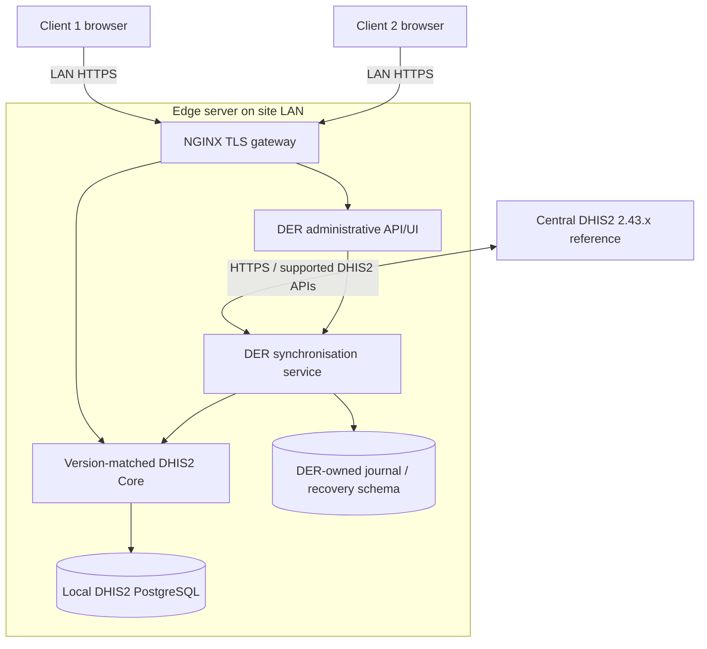

# Architecture, context and deployment

> **Project baseline:** Design and Implementation of a Conflict-Aware Edge Synchronisation Runtime for Offline-First Distributed DHIS2 Workflows. **DER target:** DHIS2 2.43+, initially pin one tested 2.43.x patch. **Status:** Design specification; neither DHIS2 integration nor passing tests is asserted. **Audience:** Student developer, supervisor, reviewers and future maintainers.

## Logical topology

## Deployment boundaries
**Client:** browser, never direct PostgreSQL access. **Edge host:** NGINX, DHIS2 Core under its supported runtime, PostgreSQL and a separately deployed DER service. **Central host:** existing authoritative DHIS2; DER has scoped integration credentials, no central schema owner privileges. **Administration:** segregated roles and endpoints; protected against ordinary client access.

## Runtime request path
Browser -> local TLS gateway -> DHIS2 supported API/application -> local transaction -> local commit response. DER journal/worker asynchronously reads the accepted change intent -> supported central API -> verifies outcome -> updates status. Inbound updates need explicit overlap/conflict/version policy.

## Design options — decision required
**A:** full local DHIS2 release. **B:** selective compatibility implementation. **C:** hybrid reuse of DHIS2 services. Evaluate functionality parity, Java/Tomcat requirements, portability, security, footprint, operation capture, API upgrade surface and proof of atomic journaling. Recommended hypothesis is A + separate DER service, but no design is approved without the spike and decision record.

## Non-goals and constraints
No guarantee against full edge-host, power or LAN outage; no P2P peer replication; no assertion of automatic compatibility with future patches; no modifications to DHIS2 internals absent documented extension design and tests.
