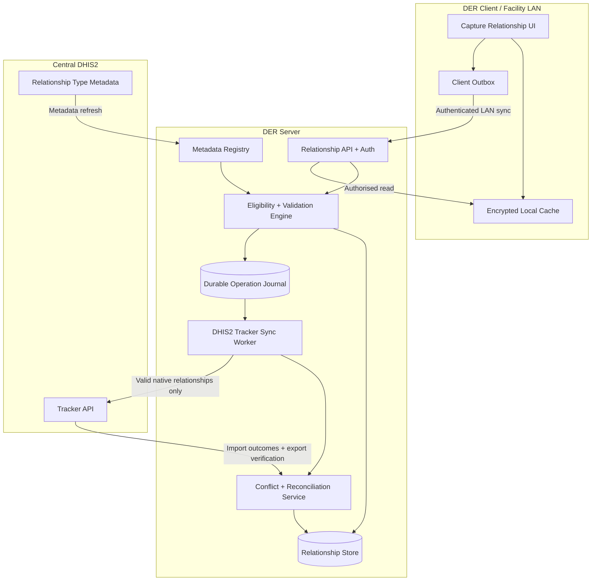

# DER Relationship Management — Server and Client Implementation Specification

**Document ID:** DER-SRS-REL-001  
**Version:** 1.0  
**Date:** 9 November 2026  
**Status:** Implementation-ready requirements and reference architecture  
**Applies to:** DER Server, DER Client Capture application, local persistence, distributed workflow services, central DHIS2 integration  
**Primary compatibility target:** DHIS2 Tracker API (test against the configured central DHIS2 version, including DHIS2 2.44 deployments)

---

## 1. Purpose and implementation mandate

Implement a complete, metadata-driven relationship management capability across the DER Server and DER Client. Users must be able to discover, create, inspect, navigate, unlink and synchronise relationships between eligible tracked entities, enrollments and events. DER must support all valid combinations offered by DHIS2 Tracker metadata, including those not exposed by the standard DHIS2 Capture application. DER must also support its own workflow, handoff, fulfilment and provenance associations without misrepresenting them as native DHIS2 relationship types.

**Central rule:** DER may send a relationship to DHIS2 **only** when its relationship type exists in central DHIS2 metadata, its endpoints satisfy the configured from/to constraints, the referenced records exist or are sent through a valid dependency-aware import, the acting integration/user identity is authorised, and validation succeeds. DER-only relationships never silently become central Tracker relationships.

The specification describes a target implementation, not an assertion that the existing DER codebase already implements these features.

### 1.1 Intended outcomes

- Equivalent relationship visibility and navigation on DER Server and Client, including offline-first use.
- Full native relationship model compatibility, without hard-coded clinical relationship types.
- Local service-point and cross-device visibility where permissions allow.
- Safe central import, export, reconciliation, rejection handling and recovery.
- Seamless relationships from patient, enrollment, event, referral, laboratory and medication workflows.
- Modern, calm, flat, accessible enterprise UI consistent with the DER Capture shell.
- Observable, auditable and testable operation under WAN interruption and concurrent editing.

### 1.2 In scope

DHIS2 relationship type metadata ingestion; nine endpoint-type combinations; search and selection; creation and unlinking; offline queue; validation; synchronization; related-stage events; workflow-specific links; permission scoping; conflict detection; duplicate prevention; timelines; graph views; background jobs; client/server APIs; diagnostics; QA and acceptance tests.

### 1.3 Out of scope / explicit boundaries

- Creating new relationship types in central DHIS2 automatically from ordinary data-entry actions.
- Treating a patient's enrollment or an enrollment's event as a relationship merely because ownership exists.
- Transmitting DER-only task assignments, device identifiers, notes or provenance in unsupported DHIS2 Tracker relationship fields.
- Guaranteeing cross-program or cross-instance relationships that central metadata or endpoint validation disallows.
- Replacing DHIS2 permissions or its validation rules with client-only checks.
- Automatically merging potentially duplicate clinical persons or overwriting contested links.

---

## 2. Standards and compatibility baseline

### 2.1 DHIS2 native relationship model

A DHIS2 relationship links two typed tracker objects, using a configured **Relationship Type** with `fromConstraint` and `toConstraint`. Its endpoint categories are `TRACKED_ENTITY`, `ENROLLMENT`, and `EVENT`. Consequently, DER shall accommodate nine *structural* directed combinations:

| From | To | Example use | Native representability |
|---|---|---|---|
| Tracked entity | Tracked entity | Mother → child; index → contact | Yes, when configured |
| Tracked entity | Enrollment | Person → specific care enrollment | Yes, when configured |
| Tracked entity | Event | Person → clinical encounter | Yes, when configured |
| Enrollment | Tracked entity | Enrollment → caregiver | Yes, when configured |
| Enrollment | Enrollment | Linked program episodes | Yes, when configured |
| Enrollment | Event | Care episode → particular event | Yes, when configured |
| Event | Tracked entity | Contact investigation → person | Yes, when configured |
| Event | Enrollment | Referral event → target enrollment | Yes, when configured |
| Event | Event | Lab request → result; referral → follow-up | Yes, when configured |

**Clarification:** All nine are possible in the Tracker *data model*. They are not automatically supported in every DHIS2 Capture UI flow, and the central instance may configure none, some or all of them. Support is always gated by actual metadata, access and server validation. The DHIS2 Capture application currently documents narrower creation flows (TE–TE, event-program event → TE from the event side, and related-stage event → event within one program).

### 2.2 Relationship direction

- **Unidirectional:** preserve the configured from/to semantics; write access to the from side and read access to the to side are required according to the documented DHIS2 rule.
- **Bidirectional:** present the relation intelligibly from either participant; write access to both sides is required; from/to metadata constraints **still matter** for payload construction.
- Never assume that bidirectional means unconstrained endpoint reversal; choose orientation according to eligibility and store the canonical orientation.
- Support `fromToName`, `toFromName` and relationship type display names where provided; never infer clinical roles from alphabetic ordering.

### 2.3 Metadata and version strategy

- Ingest `relationshipTypes` with their identifiers, names, labels, direction, constraints, display fields and relevant program/stage references.
- Resolve referenced tracked entity types, programs, program stages, OU availability and access to support selection and validation.
- Use a central-version capability registry. Detect version and feature support on connection; do not guess API parameters or assume 2.44 behaves identically to all older versions.
- Refresh metadata on administrator request, scheduled pull, reconnect and version change. Preserve last-known-good metadata with a version hash and validity status.
- If an active type disappears or becomes incompatible, retain local records, mark them `METADATA_BLOCKED`, and present an actionable remediation; do not delete silently.
- An administrator may configure DER-only display aliases, icons and categories, but must not modify central type semantics locally.

---

## 3. Domain taxonomy: three relationship classes

### 3.1 Class A — DHIS2-native tracker relationship (`DHIS2_NATIVE`)

Persist relationship UID, central type UID, two typed endpoint references, from/to orientation, client creation time, origin metadata and sync state. Publish only the DHIS2-supported subset of this model. These are stored centrally when valid.

**Examples:** mother–child; contact-of-index-case; event-to-event related stages; referral-to-follow-up when those relationship types and constraints exist.

### 3.2 Class B — DER clinical/domain associations (`DER_DOMAIN`)

Use for semantics that require more structure than a binary DHIS2 relationship, e.g. laboratory request containing five tests, prescription with multiple order lines, partial dispensing against a prescription, care-episode grouping, result amendments. These may reference DHIS2 Tracker events but must remain DER-side structures unless a **separately configured and verified** mapping into valid DHIS2 events/data elements/relationships exists.

**Clinical mapping principle:** A link describes association, not the content of a test, dosage or dispense line. Avoid modelling an entire clinical order solely as a relationship label.

### 3.3 Class C — DER operational relationships (`DER_OPERATIONAL`)

Examples: task assignment, service point handoff, workflow dependency, device provenance, work ownership, conflict review, duplicate candidate, local sync predecessor/successor. Store and replicate via authorised DER mechanisms; do **not** post through `/api/tracker` as relationships.

### 3.4 Type registry behavior

Each catalogue entry has `sourceSystem`, `scope`, `displayCategory`, `endpointTypes`, `directionality`, `constraintSnapshot`, `centralRelationshipTypeUid?`, `syncPolicy`, `allowedActions`, `requiresConfirmation`, `effectiveMetadataVersion`, and `status`. The Client shall show eligible types for the current context; administrators may hide types from a local view, but cannot bypass central permission or metadata constraints.

---

## 4. Example catalogue — configuration-driven, not hard-coded

| Category | Suggested name | Typical association | Preferred representation |
|---|---|---|---|
| Family | Mother–Child | TE ↔ TE | DHIS2 native if configured |
| Family | Parent–Guardian | TE ↔ TE | DHIS2 native if configured |
| Family | Spouse–Partner | TE ↔ TE | DHIS2 native if configured |
| Public health | Index Case–Contact | TE ↔ TE | DHIS2 native if configured |
| Public health | Exposure–Contact | Event → TE | DHIS2 native if configured |
| Clinical | Encounter Follow-up | Event → Event | DHIS2 native if configured |
| Clinical | Related Care Enrollment | Enrollment → Enrollment | DHIS2 native if configured |
| Laboratory | Consultation → Lab Request | Event → Event | Native if configured; otherwise DER domain |
| Laboratory | Lab Request → Lab Result | Event → Event | Native if configured; otherwise DER domain |
| Laboratory | Request → Test Items | One → many | DER domain composition or repeatable configured events |
| Pharmacy | Encounter → Prescription | Event → Event | Native if configured; otherwise DER domain |
| Pharmacy | Prescription → Dispensing | Event → Event | Native if configured; otherwise DER domain |
| Pharmacy | Prescription → Order Lines | One → many | DER domain |
| Referral | Referral → Receiving Encounter | Event → Event | Native if configured; otherwise DER domain |
| Coordination | Assigned to Service Point | Workflow → service point | DER operational |
| Coordination | Handoff to User/Team | Task → actor | DER operational |
| Audit | Originated on Device | Record → device | DER operational |
| Data quality | Suspected Duplicate | Record → record | DER operational until reviewed |
| Audit | Supersedes / Corrects | Record → record | DER audit/domain; mapping only where safe |

The client must not offer a central sync promise for DER-only entries. A badge or label on details can communicate `Synced to DHIS2`, `DER-only`, `Pending sync` or `Blocked`; avoid displaying numerous colored badges in dense lists.

---

## 5. User roles, access and privacy

### 5.1 Roles (capability-oriented, configurable)

- **Viewer:** read and navigate relationships only within accessible records.
- **Capture user:** create configured eligible links and inspect owned/access-permitted records.
- **Service-point coordinator:** assign/handoff DER tasks and review local work.
- **Clinical reviewer:** resolve ambiguous associations and duplicates within authorised scope.
- **DER administrator:** configure metadata sync, UI policies, diagnostics and approved DER extension mappings.
- **Integration worker:** send authorised API requests to central DHIS2 under a designated integration identity or supported delegated identity model, with traceable initiated-by context.

### 5.2 Enforcement

- Check permission on **both endpoints** and the relationship action at UI, DER API and synchronization levels.
- Access decisions must be recomputed at DER Server; never trust client-supplied `canEdit` flags.
- Respect DHIS2 tracker ownership, program access, OU access, type constraints and organisation security policies.
- Do not leak identity, programme membership or clinical attributes through relationship search suggestions, counts, thumbnails or error messages.
- Offline access: use a bounded, encrypted local dataset for previously authorised records, with policy expiry, device lock, reauthentication and revocation on reconnect.
- Make relationship type and endpoint preview fields configurable to avoid disclosing unnecessary sensitive attributes.
- For bidirectional native creation, validate required write privileges for **both** endpoints.

---

## 6. Functional requirements — DER Server

Each `SHALL` is a mandatory acceptance condition for the specified release.

| ID | Requirement | Priority |
|---|---|---|
| REL-S-001 | SHALL ingest, cache, version and index configured central DHIS2 relationship types and dependencies. | P0 |
| REL-S-002 | SHALL expose eligible relationship types per context, with direction, endpoint constraints and permissions. | P0 |
| REL-S-003 | SHALL validate all nine endpoint combinations, including type, program, stage and selected instance eligibility. | P0 |
| REL-S-004 | SHALL create native relationship records with stable UIDs, canonical orientation and idempotency keys. | P0 |
| REL-S-005 | SHALL retrieve relationships for TE, enrollment and event in either endpoint position when permitted. | P0 |
| REL-S-006 | SHALL support logical unlink and central deletion for native relationships with appropriate controls. | P0 |
| REL-S-007 | SHALL maintain a durable relationship operation journal, dependency graph and retry state. | P0 |
| REL-S-008 | SHALL send only centrally supported native relationship payloads to DHIS2 Tracker import. | P0 |
| REL-S-009 | SHALL parse and persist central validation/import outcomes per object and reconcile actual central status. | P0 |
| REL-S-010 | SHALL guard against duplicates and conflicting create/unlink operations from multiple clients. | P0 |
| REL-S-011 | SHALL maintain DER-only domain and operational associations separately. | P0 |
| REL-S-012 | SHALL audit source user, site, service point, device, timestamps and actions without exposing audit fields to central import. | P0 |
| REL-S-013 | SHALL support cursor-based lists, search, filtering, pagination and navigation through linked records. | P1 |
| REL-S-014 | SHALL support configured clinical workflows, including related-stage events, requests and fulfilment. | P1 |
| REL-S-015 | SHALL expose connection, metadata, queue, failure and conflict diagnostics in the admin console. | P1 |
| REL-S-016 | SHALL support configurable retention, export, redaction and operational metrics. | P1 |
| REL-S-017 | SHALL preserve relationships through service restart, backup/restore, and resync. | P0 |
| REL-S-018 | SHALL quarantine native relationships whose type/constraint has become invalid without silent discard. | P0 |
| REL-S-019 | SHALL not trust unsigned/unverified P2P events or permit direct client-to-central bypass of DER validation. | P0 |
| REL-S-020 | SHALL associate clinical relationships with an optional DER workflow context without adding unsupported central payload fields. | P1 |

---

## 7. Functional requirements — DER Client Capture

| ID | Requirement | Priority |
|---|---|---|
| REL-C-001 | SHALL display a `Relationships` entry point on TE detail pages and contextual links on enrollment/event detail pages. | P0 |
| REL-C-002 | SHALL show only eligible configured relationship types and permitted actions. | P0 |
| REL-C-003 | SHALL support create → select type → search/select target → preview → confirm → result. | P0 |
| REL-C-004 | SHALL support existing-record search with program/TE type/OU/stage constraints and secure results. | P0 |
| REL-C-005 | SHALL support creation of a new eligible TE/event in a dedicated page flow when permitted and applicable. | P1 |
| REL-C-006 | SHALL support edit/view and unlink, with confirmation and impact warnings. | P0 |
| REL-C-007 | SHALL make linked records navigable through clear entity/event detail pages. | P0 |
| REL-C-008 | SHALL display local, pending, synced, failed and blocked states without preventing offline work. | P0 |
| REL-C-009 | SHALL allow offline native creation against available metadata and locally known eligible endpoints. | P0 |
| REL-C-010 | SHALL prevent invalid cross-device duplicate submission through client and server reconciliation. | P0 |
| REL-C-011 | SHALL expose meaningful error and recovery steps, not raw stack traces. | P0 |
| REL-C-012 | SHALL show relationship timelines and grouping by family, clinical, public health or workflows. | P1 |
| REL-C-013 | SHALL support related-stage navigation, referral, lab and pharmacy links. | P1 |
| REL-C-014 | SHALL provide accessible keyboard/mobile navigation and responsive layouts. | P0 |
| REL-C-015 | SHALL use the shared DER design system and standard application shell. | P0 |
| REL-C-016 | SHALL separate search/list pages from edit/create forms; forms must not be embedded beside record lists as a split-page workflow. | P0 |
| REL-C-017 | SHALL support configurable reverse labels and orientation-aware explanations. | P1 |
| REL-C-018 | SHALL never imply central sync for DER-only operational links. | P0 |

---

## 8. Modern DER UI/UX specification

### 8.1 Design language

Use the existing DER app launcher → Capture app → list/search → record detail navigation. UI: modern enterprise, quiet and flat; minimal lines, minimal borders, no heavy cards, no gradients, moderate corner radius, balanced whitespace, soft elevation only where needed, clean typography, neutral backgrounds and restrained status color. Use a compact information hierarchy suitable for facility staff and touchscreen use.

### 8.2 Global navigation and screen inventory

| Screen | Entry | Purpose | Primary action |
|---|---|---|---|
| Patient/TE detail → Relationships tab | TE detail | Grouped associations with counts, status and preview | Add relationship |
| Enrollment detail → Linked records | Enrollment detail | Links for care episode and related enrollments/events | Add or open |
| Event detail → Related records | Event detail | Linked requests, results, prescriptions, referrals | Link / open related |
| Relationship directory | Contextual `View all` | Search/filter/page existing relationships | Open detail |
| New relationship: type | Add relationship | Select eligible configured type | Continue |
| New relationship: target | Wizard next page | Search/select eligible existing record | Continue |
| New relationship: review | Wizard next page | Verify orientation and clinical context | Create relationship |
| Relationship detail | List item | Participants, direction, type, sync and audit timeline | Open records / unlink |
| Related-stage create event | Event action | Schedule or create a linked event in configured stage | Save and link |
| Conflict resolution | Sync warning/admin | Review discrepancies and choose safe resolution | Resolve / escalate |
| Relationship admin | DER administration | Metadata mappings, queues, errors, feature policies | Refresh / inspect |

**Navigation rule:** Never place a full editing form next to a searchable list on the same page. Use full pages for complex selection and forms; small confirmation dialogs or action menus are appropriate for low-risk actions.

### 8.3 Relationships tab contents

- Header: `Relationships`, context breadcrumb, description, primary `Add relationship` button (if permitted).
- Tabs or segment control: `All`, `Clinical`, `Family`, `Public health`, `Workflows` (only populated/allowed categories).
- Filters: type, linked object kind, status, date, source program, service point; saved filters optional.
- List row: relationship name; target display label; reverse-aware role label; target type/context; date or recent activity; unobtrusive sync indicator; overflow actions.
- Click opens a dedicated relationship detail page; target name opens target detail using an explicit secondary action.
- Empty state distinguishes `No relationships`, `No eligible relationship types`, `No permission` and `Offline search limited`.
- Action menu: `View relationship`, `Open target`, `View timeline`, `Unlink` where authorised.
- Ensure private attributes do not appear in aggregate summaries or inaccessible search results.

### 8.4 Create relationship wizard

**Step 1 — Choose relation:** Metadata-driven eligible types displayed by category; show direction label and applicable endpoint kind. Do not offer unsupported relationships simply because a human-readable example exists in the catalogue.

**Step 2 — Choose linked record:** Scoped search by name/UID/allowed attributes, program, OU and stage. Display a stable summary with a disambiguating identifier (privacy rules apply). Offer `Create new` only when endpoint kind and permission permit it. For offline, display locally cached and newly created records, with an explanation of remote search limits.

**Step 3 — Review and confirm:** `From` and `To` with relation labels, record identifiers, type, program/stage, sync target and any outstanding prerequisites. If creation is DER-only, explicitly say `Stored in DER; not exported as a DHIS2 Tracker relationship`.

**Step 4 — Outcome:** User receives immediate local completion with `Saved locally — pending sync` if offline or awaiting central processing, followed by `Synced to DHIS2` only after confirmed acceptance. Failed sync shows a concise reason and safe retry/remediation action.

### 8.5 Event contextual actions and related stages

On a consultation event detail page, show contextual action rows: `Request laboratory tests`, `Create prescription`, `Initiate referral`, `Link follow-up`, conditioned on configured stage/relationship metadata and role. For DHIS2 related stages, allow `Schedule new related event`, `Create and capture related event`, and `Link existing event` when the applicable configuration permits. The linked event must use a separate dedicated form page; the user returns to the parent detail with its relationship visible.

If one clinical request has many tests, use a domain-specific `Lab Request` detail with repeatable test rows and distinct status/result history; only generate DHIS2 relationship links where configured. Prescription/dispensing works similarly, with partial-fulfilment accounting and no assumption that one link equals one order line.

### 8.6 Wireframe — text only

```text
DER Shell / Capture / Patients / [Patient] / Relationships

[Patient summary]  [Overview] [Enrollments] [Events] [Relationships]

Relationships (12)                          [+ Add relationship]
[All] [Clinical] [Family] [Workflows]
[Search relationships...] [Type v] [Status v] [Filters]

Mother of                         Linked person           [Open] [...]
Lab request → Results             Linked event            [Open] [...]
Referral → Follow-up              Linked event            [Open] [...]
Handoff to Laboratory             DER workflow task      [Open] [...]

Showing 1–10 of 12                         [Previous] [Next]
```

### 8.7 Responsive/accessibility requirements

- Desktop: balanced max-content width, concise list rows and ample reading space; mobile: stacked single-column rows and bottom-safe buttons.
- WCAG 2.2 AA target; keyboard focus, visible focus state, descriptive controls, semantic headings and error announcements.
- No reliance on color alone; text labels for critical sync/error states.
- Loading skeletons, optimistic save only for local completion, debounced search, cancellation of stale searches and pagination.
- No patient information in client analytics or browser console logs.

---

## 9. Server/client architecture and responsibilities



**DER Server is the authoritative local coordinator** for facility-wide state and write orchestration. Client local cache permits offline capture without assigning global conflict authority to any one device. P2P exchange, if enabled, remains an authenticated local transport and cannot override server metadata/permission/reconciliation decisions.

### 9.1 Server components

1. **Relationship Metadata Adapter:** imports and normalises relationshipTypes, constraint references, display fields, metadata hashes.
2. **Eligibility Service:** returns allowed types/actions from the current endpoint and user context.
3. **Relationship Command Service:** validates, creates, unlinks and issues immutable operation entries.
4. **Query Service:** indexed relationship lookups, joins, summary projections, privacy-safe result filtering.
5. **Sync Planner:** topologically orders referenced records and relationship operations.
6. **DHIS2 Adapter:** constructs version-safe Tracker payloads, handles async/sync jobs, validates reports and final state.
7. **Conflict Engine:** classifies duplicates, tombstones, metadata drift, stale edits, missing endpoints and access failures.
8. **Workflow Association Service:** DER-only clinical, fulfilment and task links.
9. **Audit/Observability Service:** logs decision points and metrics using minimum necessary identifiers.

### 9.2 Client components

- RelationshipListPage / RelationshipDetailPage
- RelationshipTypePickerPage / RelatedRecordSearchPage / RelationshipReviewPage
- RelatedStageActions and domain-specific lab/pharmacy/referral flows
- OfflineRelationshipRepository; OutboxManager; MetadataSnapshotCache
- PermissionAwareActions; SyncStatusPresenter; ConflictNotice
- Typed API client and schema validators; accessibility and localisation helpers

---

## 10. Logical data model and persistence

**Implementation note:** The table names below are proposals; adapt to the established DER schema and migrations. A real schema must be reviewed against existing models before migrations are merged.

### 10.1 `relationship_record`

| Field | Purpose |
|---|---|
| `id` | Internal immutable UUID primary key |
| `relationship_uid` | Stable 11-character DHIS2 UID for native class; optional for DER-only class |
| `class` | `DHIS2_NATIVE`, `DER_DOMAIN`, `DER_OPERATIONAL` |
| `relationship_type_uid` | Central DHIS2 metadata UID when native |
| `der_type_key` | Local domain/operational type when applicable |
| `from_kind`, `from_uid` | Typed endpoint reference |
| `to_kind`, `to_uid` | Typed endpoint reference |
| `orientation` | Canonical from/to as validated |
| `bidirectional` | Snapshot of central metadata, for display only |
| `metadata_version` | Hash/version used at creation |
| `site_id`, `service_point_id` | DER operational scope |
| `origin_device_id`, `origin_actor_id` | Provenance; never directly exported as tracker relationship fields |
| `created_at_local`, `updated_at_local` | DER wall clock timestamps |
| `created_at_client` | Supported DHIS2 client timestamp where applicable |
| `sync_status` | State machine status |
| `central_seen_at`, `central_import_job_id` | Reconciliation evidence |
| `is_unlinked`, `unlinked_at` | Local tombstone and delete intent |
| `revision`, `last_operation_id` | Concurrency bookkeeping |

### 10.2 Additional tables

- `relationship_type_cache` — metadata JSON, version/hash, constraints, display fields and active status.
- `relationship_operation` — immutable `CREATE`, `UNLINK`, `RELINK` as delete+create, `VERIFY`, `REPAIR` records with idempotency key, actor, device, payload hash and outcome.
- `relationship_dependency` — operation or referenced entity dependency edges.
- `relationship_sync_attempt` — retry number, request correlation, central job ID, response class, redacted errors, timestamp.
- `relationship_conflict` — category, competing versions, resolution state, reviewer, decisions and audit.
- `der_association` — structurally separate DER clinical and operational relationship records with structured metadata.
- `relationship_projection` — optional denormalized read model per endpoint for fast lists.

### 10.3 Integrity constraints

- Every native record has exactly one `from` and one `to` endpoint; each uses an allowed kind.
- A relationship points to an existing local stub or fully materialised record; dangling references are explicitly represented and block central sync until resolved.
- Store unique central UID for native relationships; reject duplicate UID with mismatched content.
- Logical duplicate key is configurable by type/endpoint pair and direction. Never globally assume multiple links of the same type are forbidden; some clinical relationships are legitimately repeatable.
- Native relationship's type/UID/from/to is effectively immutable after central creation. Change relationship type or endpoints by authorised unlink + new create, never silently update the same UID.
- Local tombstones retained until central deletion is confirmed and retention requirements are met.

### 10.4 Example internal DTO (illustrative)

```json
{
  "id": "internal-uuid",
  "class": "DHIS2_NATIVE",
  "relationshipUid": "Abcdef12345",
  "relationshipTypeUid": "Rtype12345",
  "from": {"kind": "EVENT", "uid": "Event12345"},
  "to": {"kind": "EVENT", "uid": "Result12345"},
  "metadataVersion": "sha256:...",
  "syncStatus": "PENDING",
  "workflowContextId": "internal-workflow-uuid",
  "origin": {"siteId": "site-1", "servicePointId": "laboratory"}
}
```

Identifiers in examples are illustrative; they do not represent existing DHIS2 objects or metadata.

---

## 11. DER Server API contract (proposed, not DHIS2 endpoints)

Prefix recommended: `/api/v1/relationships`. The actual DER API shall use authenticated HTTPS (or equivalent secure LAN transport), scoped tokens and an explicit API version.

| Method | Route | Function |
|---|---|---|
| GET | `/api/v1/relationship-types?contextKind=EVENT&contextUid=...` | Eligible metadata with display and actions |
| GET | `/api/v1/relationships?endpointKind=EVENT&endpointUid=...` | Search/paginated list for either endpoint side |
| GET | `/api/v1/relationships/{id}` | Relationship detail and permissions |
| POST | `/api/v1/relationships` | Create a relationship command |
| POST | `/api/v1/relationships/{id}/unlink` | Audited unlink command |
| GET | `/api/v1/relationships/{id}/history` | Audit and sync timeline |
| GET | `/api/v1/relationships/{id}/status` | Local and central sync status |
| POST | `/api/v1/relationships/{id}/retry` | Permission-gated retry of remediable failure |
| GET | `/api/v1/related-records/search` | Secured endpoint-specific search |
| GET | `/api/v1/relationship-conflicts` | Authorised conflict work queue |
| POST | `/api/v1/relationship-conflicts/{id}/resolve` | Documented resolution decision |
| GET | `/api/v1/admin/relationships/sync-health` | Queue metrics and errors |
| POST | `/api/v1/admin/relationship-types/refresh` | Metadata refresh |

Suggested client write request:

```http
POST /api/v1/relationships
Idempotency-Key: 8d73...client-generated-unique-token
Content-Type: application/json
Authorization: Bearer <scoped-token>
```

```json
{
  "class": "DHIS2_NATIVE",
  "relationshipTypeUid": "Rtype12345",
  "from": {"kind": "EVENT", "uid": "Event12345"},
  "to": {"kind": "EVENT", "uid": "Result12345"},
  "clientCreatedAt": "2026-11-09T12:00:00Z",
  "expectedMetadataVersion": "sha256:..."
}
```

The server responds with the durable local record, derived state and permitted actions. Never accept `originActorId`, `syncStatus`, `centralAccepted` or access grants as authoritative from the client. Require request IDs, optimistic concurrency tokens where needed, consistent error codes and rate limiting.

### 11.1 Error taxonomy

`REL_TYPE_NOT_FOUND`, `REL_TYPE_INACTIVE`, `INVALID_FROM_CONSTRAINT`, `INVALID_TO_CONSTRAINT`, `RECORD_NOT_ACCESSIBLE`, `TARGET_NOT_FOUND`, `DUPLICATE_RELATIONSHIP`, `STALE_METADATA`, `CENTRAL_NOT_CONFIGURED`, `PENDING_ENDPOINT_SYNC`, `SYNC_IMPORT_REJECTED`, `CENTRAL_LINK_DELETED`, `CONCURRENT_UNLINK`, `REAUTH_REQUIRED`, `OFFLINE_SEARCH_UNAVAILABLE`.

Every error response must contain a safe user message, stable code, correlation ID, retryability flag and documented remediation. Never expose sensitive inaccessible record details.

---

## 12. Central DHIS2 API integration

**The modern Tracker API is the preferred interface.** DHIS2 documents `POST /api/tracker` for imports, `GET /api/tracker/relationships` for relationship export, and `POST /api/tracker?...&importStrategy=DELETE` for deletion. The deprecated `/api/relationships` CRUD endpoints should not be the default implementation for modern DHIS2 versions.

### 12.1 Read central relationship metadata

Illustrative metadata retrieval (test supported `fields` and endpoint behavior against the connected version):

```http
GET /api/relationshipTypes?fields=id,name,code,bidirectional,fromToName,toFromName,fromConstraint,toConstraint&paging=false
```

Avoid fetching all metadata on every patient view: use DER Server's cached registry with controlled refresh. Some payload fields and display properties vary across DHIS2 versions; the adapter must normalise and test exact metadata structures.

### 12.2 Read existing central relationships

```http
GET /api/tracker/relationships?trackedEntity={trackedEntityUid}
GET /api/tracker/relationships?enrollment={enrollmentUid}
GET /api/tracker/relationships?event={eventUid}
```

Use exactly one endpoint filter per request. The returned set is limited by the central user's access. Do not treat a missing relationship due to restricted access as definitive evidence that no relationship exists. Request explicit `fields` when needed and normalise response to the local projection.

### 12.3 Create central relationship

```http
POST /api/tracker?async=false&importMode=COMMIT
Content-Type: application/json
Authorization: Bearer <integration-credential>
```

```json
{
  "relationships": [
    {
      "relationship": "Abcdef12345",
      "relationshipType": "Rtype12345",
      "from": {"event": {"event": "Event12345"}},
      "to": {"event": {"event": "Result12345"}},
      "createdAtClient": "2026-11-09T12:00:00Z"
    }
  ]
}
```

The example assumes the central relationship type accepts event → event and that both referenced events are valid. The example UIDs must be replaced with real valid identifiers. The adapter must whitelist only supported relationship fields; never include DER internal state, custom notes, devices or service point assignments in this payload.

**Validate first** when the version supports an appropriate validation-only import (`importMode=VALIDATE`), especially for bulk or high-risk changes; validation is advisory and does not replace atomicity/verification on commit. Import behavior and available flags must be version-tested.

### 12.4 Create prerequisites safely

If endpoints are new or pending central import, plan the dependency ordering `tracked entity → enrollment → event → relationship` as applicable; exploit nested/bundled Tracker imports only when the target version supports the intended semantics and reports are verified. A relationship must not be reported as synced before its endpoint prerequisites are confirmed. Retry should re-use stable UIDs and idempotency tracking.

### 12.5 Unlink/delete central relationship

```http
POST /api/tracker?async=false&importStrategy=DELETE
Content-Type: application/json
```

```json
{
  "relationships": [{"relationship": "Abcdef12345"}]
}
```

Delete only after a user-confirmed authorised unlink. Do not delete the linked TE, enrollment or event as a side effect of unlink. Where a linked event must also be deleted, this is a **separate**, higher-risk, permission-gated action with an impact preview.

### 12.6 Central response handling

- Capture HTTP status, import summary/stats, per-object error and warning classification, and asynchronous job reference if used.
- HTTP `200/201/202` alone is **not** proof of successful import of every relationship. Parse the Tracker import report and confirm object-level results.
- For async imports, poll the documented job endpoint/continuation mechanism supported by that version.
- Use a final export/read-back check in ambiguous cases and during reconciliation; a failed or unavailable read-back must be treated carefully when access visibility is restricted.
- Translate central validation errors into actionable DER UI messages; preserve raw central responses only in restricted, redacted diagnostic storage.

---

## 13. Offline, LAN distribution and sync state machine

### 13.1 Required states

`LOCAL_DRAFT` → `PENDING_SERVER` → `PENDING_DEPENDENCIES` → `READY_TO_SYNC` → `SYNCING` → `SYNCED`. On exceptions: `RETRYABLE_ERROR`, `VALIDATION_BLOCKED`, `METADATA_BLOCKED`, `ACCESS_BLOCKED`, `CONFLICT_REVIEW`. For unlink: `UNLINK_PENDING` → `UNLINK_SYNCING` → `UNLINKED_CONFIRMED`. DER-only associations use a separate `DER_REPLICATED` status and have **no** central Tracker sync route.

### 13.2 Client-to-server sequence

1. Client loads last authorised metadata snapshot, context and cached record references.
2. Capture user creates link offline or online; client validates available constraints, assigns command ID and writes transactionally to encrypted outbox/local read model.
3. On LAN availability, client transmits command with stable idempotency key and auth to DER Server.
4. Server rechecks permissions/metadata, assigns immutable operation sequence and commits relationship + journal atomically.
5. Server broadcasts an authorised change notification or supports scoped incremental polling to other clients at the site.
6. Other clients update their local projections subject to access controls, without learning inaccessible relationships.
7. Central Sync Worker waits for WAN and prerequisites, imports the link, records outcomes and eventually notifies clients of central state.

### 13.3 Offline-specific rules

- A device may not search inaccessible central records offline. Only locally provisioned or locally created permitted references are available.
- If the target is not cached, offer `Save a draft` without pretending the relationship is fully valid, or defer target selection until access returns.
- Client-side clock is not authoritative for conflict ordering. Use monotonic operation sequence and server-confirmed revisions, with timestamps only for audit context.
- Changes from distinct devices converge through DER Server; no blind LWW for link/unlink races, duplicate links or clinical relationship identity.
- P2P messages, if used, carry signed/authorised operations and are replay-safe; server reconciliation remains required.
- On device loss or reset, queued non-synced operations need an explicitly documented backup/restore and re-enrolment policy.

### 13.4 Sync idempotency and retries

- Maintain unique `clientCommandId` plus server operation ID; duplicate submissions return the prior result.
- Use preallocated immutable central UIDs when valid and supported; avoid generating a new UID on each retry.
- Exponential backoff with jitter for network/5xx, bounded retry budget and dead-letter review.
- Do not auto-retry non-retryable metadata, permission or semantic validation failures without remediation.
- Deduplicate incoming central export against local UIDs and validated endpoint signatures.
- When import acknowledgment is lost, query/read back the exact UID where permitted before attempting another create.

---

## 14. Conflict classification and resolution

| Conflict | Detection | Default action |
|---|---|---|
| Same link created by two devices | Same semantic identity/uniqueness key or central UID collision | Deduplicate if clearly equivalent; preserve audit |
| Concurrent create vs unlink | Operations against same link and incompatible revision | Freeze central change; reviewer or deterministic policy based on verified ordering |
| Endpoint deleted centrally | Reconciliation finds referenced object deleted | Block, retain tombstone and notify owner |
| Endpoint inaccessible | Permission/ownership now denies access | Block, do not disclose target; reauthenticate/escalate |
| Relationship type removed | Metadata hash/type lookup fails | `METADATA_BLOCKED`; admin remap review |
| Relationship constraint changed | Endpoint type, program or stage mismatch | Stop sync and require valid corrective action |
| Native relationship changed endpoints/type | Mutation attempts to alter immutable identity | Reject; create new only after approved unlink |
| Same target chosen accidentally | Duplicate business-rule check | Warn/confirm or reject based on configured policy |
| Ambiguous central outcome | Import response missing/failure after timeout | Verify by UID and import job before retry |
| DER-only association unexpectedly mapped | Adapter detects unsupported central type | Reject central posting; remain DER-only |

**Resolution hierarchy:** safe deterministic idempotence first; verified central state second; domain-rule resolution where unambiguous third; authorised human review for clinical ambiguity. **Do not use unconditional last-write-wins** on relationship endpoints, unlinking or permission-sensitive operations.

The reviewer interface must show: conflicting actions, actors/site timestamps, central/local status, type/constraints, potential care impact, resolution choices and audit trail. Suggested decisions: `Keep existing`, `Accept new and unlink prior`, `Retain both where allowed`, `Rebind after verification`, `Escalate`. Never silently merge patient identities.

---

## 15. Example workflow requirements

### 15.1 Mother–child link

Patient detail → Relationships → Add → configured `Mother–Child` type → find/select second patient → review mother/child orientation → create local relationship → sync. If type requires enrollment conditions (e.g. maternal/child programme membership), eligibility must validate those conditions. Show reverse-aware role text when viewed from child's record.

### 15.2 Laboratory investigation

Consultation event → `Request laboratory tests` → dedicated Lab Request page → add one or many tests including test-specific attributes, sample status, priority and reason (according to configured clinical metadata) → save request event/domain record → create native event-event relationship only if configured → laboratory worklist receives authorised task → results linked to request → consultation displays latest status and opens the result detail. Multiple tests are not collapsed into one generic relationship type; each test has its own structured lifecycle.

### 15.3 Prescription and dispensing

Encounter detail → `Create prescription` → dedicated page with multiple medicines, dosage/instructions and quantities → save → pharmacy worklist → partial/complete fulfilment with independent dispensing entries → show `Prescribed`, `Partially dispensed`, `Dispensed`, `Cancelled`. Link configured DHIS2 events where valid; line-item fulfilment stays DER domain data unless supported by configured central metadata and mapped events.

### 15.4 Referral and distributed handoff

Event → initiate referral → select authorised receiving service point/OU and referred clinical context → create configured native link when available; separately create DER handoff with assigned worker, work status, due date and audit → receiving team opens a work queue and creates follow-up event → link follow-up to referral when eligible → originating clinical detail shows receiving status. Do not place DER staff assignments in DHIS2 relationship payloads.

### 15.5 Contact investigation

Index case → `Add contact` → search or create authorised contact TE → configured native contact relationship → contact investigation event(s) and follow-up as metadata permits → distinct privacy treatment for public-health sensitive details.

---

## 16. Administrator configuration and operations

### 16.1 Admin console tabs

`Overview` · `DHIS2 Relationship Types` · `DER Association Types` · `Mappings` · `Sync Queue` · `Conflicts` · `Audit` · `Settings`.

Show: current DHIS2 version/endpoint health; last successful metadata refresh; number of active native types; eligible combination counts; queued/blocked/failed imports; missing referenced objects; drift warnings; average sync lag; manual controlled retry and export audit.

### 16.2 Administrator safeguards

- Native type definitions are centrally owned and read-only in DER; admin may configure local presentation and DER-only mappings with explicit review.
- Test mapping in dry-run mode and require explicit enablement before central posting.
- Feature flags per program/site/role and compatibility test status.
- Queue inspection and item-level retry without permitting bulk unsafe replay.
- No credential disclosure in settings, logs or support exports.
- Support metadata snapshot rollback only for UI continuity, not as authority to post a now-invalid relationship to central.

---

## 17. Non-functional requirements and targets

| ID | Target / requirement | Verification |
|---|---|---|
| NFR-REL-001 | No confirmed local command is lost across DER Server restart; transactional DB + journal. | Crash/restart test |
| NFR-REL-002 | Relationship list renders initial locally available results within 1 s p95 on standard facility LAN, under defined test dataset. | Load benchmark |
| NFR-REL-003 | Local UI create action returns saved-local acknowledgement within 500 ms p95 on reference device after durable write. | Client test |
| NFR-REL-004 | Server validation enforces zero unauthorised relationship disclosures or posts across tested role matrix. | Security tests |
| NFR-REL-005 | All API write operations are idempotent under duplicate command replay. | Fault injection |
| NFR-REL-006 | Sync resumes after WAN loss and successful dependency reconciliation without manual resubmission. | Outage/recovery test |
| NFR-REL-007 | Sensitive local cache encrypted at rest; secure transport, scoped tokens, session expiry. | Security review |
| NFR-REL-008 | UI follows WCAG 2.2 AA for supported flows; keyboard/touch operable. | Accessibility audit |
| NFR-REL-009 | Sync metrics and correlation tracing exist without exposing clinical data in telemetry. | Observability test |
| NFR-REL-010 | A configurable retention/backup/restore policy protects unsynced operations and tombstones. | Recovery test |
| NFR-REL-011 | Metadata incompatibility is detected before central posting and shown as actionable. | Metadata drift tests |
| NFR-REL-012 | Load tests cover at least 50 concurrent facility clients and dataset sizes agreed during capacity planning; tune targets from measured baseline. | Performance test |

Performance values are **proposed acceptance targets**, not verified characteristics of current DER deployments; revise after baseline measurements on reference devices and infrastructure.

---

## 18. Test strategy and acceptance matrix

### 18.1 Contract and metadata tests

- Import all relationship types from a controlled DHIS2 instance; verify constraint, label, direction and reference accuracy.
- Test the nine endpoint-type combinations with deliberately configured metadata and actual supported 2.44 APIs.
- Negative cases: wrong TE type, wrong program/stage, inaccessible target, wrong orientation, missing type, removed type.
- Validate central import/export round-trip and correct per-object report parsing.
- Re-run against each deployed DHIS2 version in the compatibility matrix.

### 18.2 End-to-end acceptance cases

| Case | Setup/action | Expected result |
|---|---|---|
| AT-01 | Native TE→TE configured; create online | Link visible on eligible details and confirmed centrally |
| AT-02 | Native Event→Event configured; create during WAN outage | Saved locally; queued; eventually synced after restoration |
| AT-03 | Eligible type absent centrally | No central-create action; DER-only option clearly distinguished if configured |
| AT-04 | Bidirectional creation without write on target | Denied at server; no leak of target information |
| AT-05 | Unidirectional valid from write/to read | Can create if all other constraints and central permissions allow |
| AT-06 | Two clients create identical non-repeatable link | One logical active link; complete audit history |
| AT-07 | Client repeats same write after timeout | Same operation and UID; no duplicate import |
| AT-08 | Parent event not centrally imported yet | Relationship waits for event dependency |
| AT-09 | Metadata constraint changes during queueing | Item blocked and admin/user informed; no invalid post |
| AT-10 | User unlinks relationship | Link removed in DER; central deletion confirmed; endpoints retained |
| AT-11 | Central rejects a relationship | Visible actionable failed/blocked status; no false sync success |
| AT-12 | Source device restarts with pending changes | Durable outbox resumes after restart and auth |
| AT-13 | Restricted related patient in search | No identifying results or side-channel disclosure |
| AT-14 | Lab request with three tests and subsequent results | Line items and valid configured related-stage links preserved |
| AT-15 | Partial medication dispensing | Prescription remains partially fulfilled with traceable entries |
| AT-16 | DER-only handoff | Visible to authorised LAN users; never sent as central relationship |
| AT-17 | Unlink and create race | Explicit conflict or safe ordered resolution; no blind LWW |
| AT-18 | Patient context and event detail navigation | Relationships reachable without mixed list/form page layout |
| AT-19 | Read central relationship linked on `to` side | Presented according to access and central API semantics |
| AT-20 | Reconnect after long WAN outage | Dependencies, queue and central states converge or are clearly blocked |

### 18.3 Security tests

Broken object-level authorisation (BOLA), cross-OU visibility, role changes, stale offline access, token expiry/revocation, P2P message replay, malicious relationship type UID injection, endpoint type substitution, XSS in metadata labels, excessive enumeration, central account over-privilege, audit-log exfiltration.

### 18.4 Performance and resilience tests

Measure relationship search latency, list p95, local write durability, inter-client visibility lag, import throughput, conflict detection precision, duplicate rate, backlog drain time, restart recovery and data integrity across failure scenarios.

---

## 19. Implementation phases and concrete deliverables

### Phase 1 — Native foundation (must ship before advanced workflows)

- Metadata adapter + capability matrix + relationship type cache.
- Endpoint eligibility + permission rules + native relational schema.
- DER Server create/read/unlink/status APIs; transactional journal and idempotency.
- Capture Relationships tab, create wizard, detail view, search, status.
- Central import/export/delete adapter + report parsing and audit.
- Automated 9-combination metadata/contract tests and negative tests.

**Exit:** A configured relationship can be created and viewed through DER, persisted offline, synchronised and verified centrally without bypassing constraints.

### Phase 2 — Related clinical workflows

- Related stages; contextual event actions; laboratory request/results; prescription/dispensing; referral follow-up.
- DER-only domain association service and clear native/DER distinctions.
- Secure distributed service-point worklist, handoff and event navigation.
- Relationship timeline, grouped lists, record summary projections.

**Exit:** A cross-service-point clinical workflow links related events and DER tasks while preserving native interoperability.

### Phase 3 — Conflict, recovery and hardening

- Advanced concurrency handling, conflict review, replay, retry, drift quarantine.
- Optional secure P2P transport with DER Server reconciliation.
- Admin metrics, bulk diagnostics, backup/restore and load testing.
- Security audit, WCAG 2.2 AA review, cross-version compatibility matrix.

**Exit:** No silent relationship loss or false central sync claims under tested WAN/device/restart/concurrency failures.

---

## 20. Definition of done and engineering handoff checklist

- [ ] Native type registry is read from actual DHIS2 metadata and versioned.
- [ ] All nine structural endpoint combinations are supported and constrained correctly.
- [ ] No relationship is shown as syncable if its central type/configuration is absent.
- [ ] All CRUD-related interactions use explicit role-checked DER APIs.
- [ ] Create and unlink are journaled and idempotent.
- [ ] Offline queue is durable and accessible only to the authorised user/device.
- [ ] Prerequisite objects sync before the relationship when required.
- [ ] Tracker import reports and read-back behavior are interpreted correctly.
- [ ] Central rejection is visible with clear remediation and audit.
- [ ] DER-only domain and operational associations cannot accidentally be posted centrally.
- [ ] No unconditional LWW for clinical relationship conflicts.
- [ ] UI follows dedicated list/search and form/detail pages, not a combined split-page form.
- [ ] Related-event flows work for laboratory, pharmacy and referral configurations.
- [ ] Automated unit, integration, E2E, security and outage tests are passing.
- [ ] API schema, database migrations, runbooks, support notes and screenshots are committed with the implementation.

---

## 21. Suggested repository documentation and code organisation

Adapt to existing stack rather than restructuring a working codebase unnecessarily.

```text
docs/
  requirements/relationships.md
  architecture/relationship-sync.md
  api/relationship-api.md
  ui/relationship-capture-flows.md
  qa/relationship-acceptance-matrix.md
server/
  domain/relationships/
  application/relationships/
  integrations/dhis2/tracker-relationships/
  infrastructure/persistence/relationships/
client/
  features/relationships/
    pages/
    components/
    data/
    state/
  features/capture/related-records/
tests/
  contracts/dhis2-relationships/
  e2e/relationships/
  resilience/relationship-sync/
```

No implementation may invent central relationship metadata, bypass the central configured types or treat prototype UI examples as real central configuration. Begin by reviewing current DER server/client architecture and making a change-impact inventory; implement incrementally with migrations, compatibility tests and screenshots matching the actual UI.

---

## 22. Engineering decision log (recommended ADRs)

- **ADR-REL-001:** Central DHIS2 owns native relationship type semantics.
- **ADR-REL-002:** DER Server coordinates local authoritative state; offline clients stage commands.
- **ADR-REL-003:** Domain and operational associations are stored separately from native relationships.
- **ADR-REL-004:** Stable UIDs, immutable operation journal and idempotent central sync.
- **ADR-REL-005:** Clinically ambiguous conflicts require verification or reviewer adjudication; no unconditional LWW.
- **ADR-REL-006:** Relationship list, detail, search and create are separate navigable screens.
- **ADR-REL-007:** Central import status is confirmed from object-level results and reconciliation, not HTTP success alone.

---

## 23. Source references and verification notes

1. DHIS2, **Tracker API (current documentation)**: https://docs.dhis2.org/en/develop/using-the-api/dhis-core-version-master/tracker.html — Tracker relationships, import/export, endpoint filters, and deletion strategy.
2. DHIS2, **Tracker API 2.40**: https://docs.dhis2.org/en/develop/using-the-api/dhis-core-version-240/tracker.html — version-sensitive baseline and legacy migration notes.
3. DHIS2, **Configuring programs / relationship types (2.43)**: https://docs.dhis2.org/en/use/user-guides/dhis-core-version-243/configuring-the-system/programs.html — relationship type constraints, directionality and Capture UI limitations.
4. DHIS2, **Relationship model**: https://docs.dhis2.org/en/use/user-guides/dhis-core-version-240/understanding-the-data-model/relationship-model.html — from/to constraints, bidirectional presentation and access semantics.
5. DHIS2 Capture source documentation, **Related stages and linked events**: https://github.com/dhis2/capture-app/blob/master/docs/user/using-the-capture-app.md — relevant Capture workflow reference.

**Verification gate for implementation:** Before production rollout, replay the API contract against the **exact deployed DHIS2 version/build**, inspect actual `/api/relationshipTypes` responses, test all configured endpoint combinations, and confirm Tracker import/delete response formats. This specification includes planned DER APIs, schema, targets and UI patterns which are **design proposals**, not DHIS2 product guarantees.
